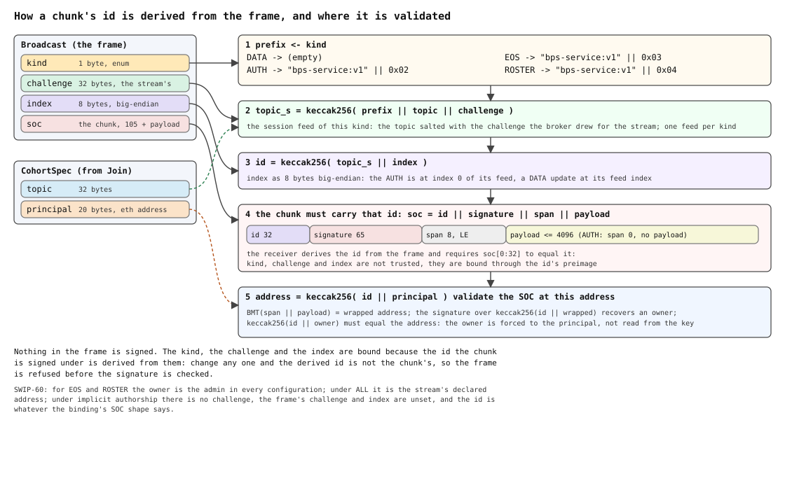

<!-- Full singlehop SWIP of the Broadcast Pub/Sub (BPS) family: the decomposition of the
monolithic PubSub SWIP (ethersphere/SWIPs PR #93) into work-package-sized SWIPs. Extends
the base wire of SWIP-74 (BPS-lite, PR #111) and changes nothing in it. Companion
protobuf: assets/swip-60/bps.proto (revision 16, derived from SWIP-74's block). Rev 13
follows SWIP-74 rev 10: the `AUTH` is the only way a stream authenticates, a pending
stream sends nothing else, and what earlier revisions called the claim is the auth; a
glossary, an outcomes table, a replay table and a figure of the id derivation are added. -->

- **Business line**: real-time topic streams for dApps without storing chunks or polling —
  enough on its own for the five cohort shapes it defines: **jam** (a closed set of authors:
  collaborative remix editing, a strudel livecoding session, a multiparty game),
  **spectator-jam** (the same before an audience), **live-stream** (one author, an audience),
  **group-chat** (everyone speaks) and **implicit** (a live feed with no authority at all).
  An admin grants and revokes authors while a cohort runs, without redefining it.
- **Dev line**: implement one libp2p protocol (`bps/1.0.0`, messages in
  [bps.proto](assets/swip-60/bps.proto)) plus a WebSocket bridge on the Bee API; done when
  a broker, publishers and subscribers interoperate per the conformance section. Groundwork
  exists in bee [#5435](https://github.com/ethersphere/bee/pull/5435).
- **Base**: [SWIP-74 BPS-lite](https://github.com/ethersphere/SWIPs/pull/111) — one
  publisher over a feed, one broker, one hop, three frames and a per-stream challenge that
  salts every chunk, and an `AUTH` — the empty chunk at index 0 of the session's `AUTH`
  feed — that authenticates the stream. This
  SWIP adds cohort parameters, the admin's service kinds and the Bee API on top of that
  wire and never changes it: a SWIP-74 peer is a conformant peer of the live-stream
  configuration below.
- Bandwidth-incentive integration is a separate SWIP (bps-bw-incentives).
- Broker discovery integration is from a separate SWIP (bps-broker-discovery, building on
  [SWIP-59 MEX](https://github.com/ethersphere/SWIPs/pull/103)).

## Simple Summary

A real-time messaging protocol: WebSocket clients publish and subscribe to topic streams
through Bee nodes. One full node per cohort acts as **broker**, re-broadcasting each message
over direct, long-lived p2p streams to a capacity-bounded set of connected peers. Messages are
single-owner chunks, so every subscriber verifies authorship end-to-end; the broker can
withhold, never forge.

## Motivation

Swarm's event primitives (GSOC, PSS) require full-node operation; light clients can only
poll storage. [SWIP-74](https://github.com/ethersphere/SWIPs/pull/111) is the smallest
protocol that fixes this for one publisher; BPS singlehop is the smallest that fixes it for
every cohort shape, on the same wire: one broker, direct streams, authenticated messages,
an admin's control plane, an explicit capacity bound. Everything larger — multihop trees,
adaptive reorganisation, incentives, discovery — is layered on top by later SWIPs without
changing the semantics defined here.

## Specification

### Terms

The base terms are SWIP-74's, repeated here so that this SWIP reads on its own; the
rows after **admin** are this SWIP's additions.

| term | meaning |
|---|---|
| **channel** | what an application streams on: a topic and, under explicit authorship, its admin's address, independent of any broker |
| **cohort** | the live state of one channel at one broker: the streams attached under one spec, created by the first `Join` that names the spec, reclaimed by inactivity or ended by an `EOS` |
| **cohort spec**, `CohortSpec` | `{topic, binding, principal?, publishers?, closed?, history?}`: the cohort's identity, immutable, carried in full in every `Join` |
| **topic** | 32 bytes: what the binding binds to |
| **broker** | the full node every stream of the cohort is attached to: it validates, keeps the cursors and fans out; it can withhold, never forge |
| **peer** | a node connected to the broker; one peer connection may hold several streams |
| **stream** | one libp2p stream `/swarm/bps/1.0.0/bps` from a peer to the broker, for one cohort and one identity: the unit of role, flow control and teardown |
| **identity** | the address a stream declares in `Join`: the one it publishes as, if it may |
| **frame** | one protobuf message on a stream: `Join`, `Ack` or `Broadcast`; what a frame is follows from the stream's direction and role, never from an envelope |
| **handshake** | the first frame each way: `Join{cohort, identity}` from the peer, `Ack{status, challenge}` from the broker |
| **challenge** | 32 bytes the broker draws at random for each stream and sends in the `Ack`: it salts the session feed and is never persisted or reused |
| **single-owner chunk**, SOC | `id (32) ‖ signature (65) ‖ span (8) ‖ payload (≤ 4096)`, stored and validated at `keccak256(id ‖ owner)`; every chunk on this wire is one |
| **kind** | what a chunk is: `DATA`, `AUTH`, `EOS` or `ROSTER`; carried in the frame, it selects the feed's prefix |
| **session feed** | the channel's feed salted for one stream: topic `keccak256(prefix ‖ topic ‖ challenge)`, one feed per kind, each with its own index sequence; the chunk id is `keccak256(topic_s ‖ index)` (SWIP-74) |
| **index** | the chunk's position on its feed: 8 bytes big-endian in the frame and in the id's preimage |
| **update**, publication | a `DATA` frame from a publisher stream |
| **auth** | the act and the frame that authenticate a stream: the **`AUTH`**, an empty SOC at index 0 of the session's `AUTH` feed, which upgrades a stream that may authenticate and is never delivered |
| **heartbeat** | an `AUTH` on a publisher stream: counts as activity, does nothing else |
| **delivery** | an accepted frame forwarded unchanged — chunk, kind, challenge, index — to every stream in a fan-out set not bound to the publishing identity |
| **fan-out set** | the streams of a cohort that receive deliveries, bounded per cohort |
| **cursor** | the lowest index accepted next: at the broker one per publisher and one for the roster feed, at a subscriber the same, kept across streams |
| **retransmit** | a frame below its cursor: dropped and counted, not a violation |
| **violation** | a frame a stream may not send, or a chunk that does not validate: dropped, counted, the stream reset, the peer blocklisted |
| **inactivity deadline**, **auth deadline** | how long a cohort survives without an accepted frame; how long a pending or silent stream has to send its `AUTH` |
| **principal**, **admin** | the address in the spec: under explicit authorship the **admin** — the cohort's authority, the only writer of the service feeds, always a publisher |
| **explicit authorship** | `principal` set: the admin and the addresses its roster names may publish; every such stream is authenticated by its `AUTH` and every chunk salted by its stream's challenge |
| **implicit authorship** | `principal` absent: who may publish follows from the binding's SOC shape; no auth, no salt, dedup on chunk address |
| **`ALL`** | the one `publishers` value: anyone attached may publish; a stream declaring an address is a publisher stream from its `Join`, no auth, every chunk still salted and held to the declared address |
| **binding** | what the topic binds to — `MNEMONIC`, `ANCHOR`, `SOC_ID`, `OWNER`, `FEED_TOPIC` — which fixes which SOCs qualify under implicit authorship and the dedup rule there |
| **roles** | **subscriber stream** — receives, sends nothing (SWIP-74). **Pending stream** — declared the admin's or a rostered address, not yet authenticated: receives nothing but the roster that names it, sends nothing but its `AUTH`, admitted outside the fan-out bound. **Publisher stream** — authenticated, or declared under `ALL` or implicit authorship: sends publications, heartbeats and, if it is the admin's, service messages. **Spectator stream** — under explicit authorship, an identity neither the admin's nor rostered: within the bound, receives, sends nothing, may authenticate once a roster names its address. **Silent stream** — a spectator in a `closed` cohort: receives nothing but a roster naming it, disconnected at the auth deadline unless it authenticates |
| **roster** | the admin's complete publisher set, published as a `ROSTER` chunk on the admin's roster feed; the latest one the broker holds is the first delivery on every stream entering a fan-out set |
| **rostered** | named by the latest roster the broker has accepted |
| **service message**, service feed | the admin's control plane: `EOS` and `ROSTER`, each a kind with its own session feed, the owner forced to the admin |
| **`EOS`** | end of stream: the empty chunk at index 0 of the admin's `EOS` feed; ends the channel, attributably and for good |
| **grant**, **revocation** | the admin adding or removing an address by publishing the next roster: a grant takes effect at the grantee's `AUTH`, a revocation once the reduced roster has reached the revoked stream and a grace period has passed |
| **`closed`** | no audience: every stream is silent until its `AUTH` validates for the admin's or a rostered address |
| **`history`** | deliver matching chunks from the local store on attach (mechanism in bps-history) |
| **dApp**, bridge | the application behind the Bee API's WebSocket endpoints; the node joins, validates and relays on its behalf and holds no key |

### The contract

Per topic-cohort:

- messages come from **publishers, and publishers only**;
- they arrive at **all subscribers**.

### Cohort genesis: the parameters

A cohort is fully described by a `CohortSpec` ([bps.proto](assets/swip-60/bps.proto)), fixed
the moment the first peer brings it to a BPS-speaking full node, and **immutable for the
cohort's lifetime**. **The spec is the cohort's identity**: every joiner carries it, cohorts
are keyed by its canonical serialisation (SWIP-74), and two specs that differ in any field
are two cohorts, even on one topic. There is no mode
enum; **modes are combinations of these parameters**.

| parameter | values | meaning |
|---|---|---|
| `topic` | 32 bytes | interpreted per `binding` |
| `binding` | `MNEMONIC` / `ANCHOR` / `SOC_ID` / `OWNER` / `FEED_TOPIC` | what the topic binds to; fixes which SOCs qualify as messages and the dedup rule |
| `principal` | eth address | the admin: the cohort's authority and a member of its publisher set — not necessarily the first to join. **Absent ⇒ implicit authorship**, and the two fields below do not apply |
| `publishers` | `ALL` or unset | set: anyone attached may author — no auth; a stream declares the address it publishes as, and every message it sends is validated against it. Unset: the admin, and whoever its roster ever names — **a cohort is multi-publisher iff its admin ever publishes a roster**, and nobody needs to know in advance |
| `closed` | bool, unset = open | set: no audience — every stream is admitted silent, receiving nothing but a roster that names its address, and is disconnected unless its `AUTH`, for the admin's or a rostered address, arrives within the auth deadline |
| `history` | bool | deliver matching chunks already in the local store (mechanism in bps-history; a singlehop broker MAY refuse) |

**The publisher list is deliberately not here.** It is dynamic — an admin grants and revokes
while the cohort runs — and this spec is immutable, so it cannot live in it without making
every roster change a new cohort. It is also not public in the way the rest of the spec is:
the owner of a stream, or of a co-edited file, is naturally known to its subscribers, but the
other grantees are not. The roster therefore travels as **admin-signed service messages on a
feed of its own** (below), where it changes without the cohort changing, and where a
subscriber verifies it against the admin's key rather than against the broker's word.

#### The five configurations

| configuration | `principal` | `publishers` | `closed` | who may author |
|---|---|---|---|---|
| **jam** | set | unset | true | admin + current grantees; nobody else attends |
| **spectator-jam** | set | unset | unset | admin + current grantees, before an audience |
| **live-stream** | set | unset | unset | the admin alone, before an audience — **SWIP-74's cohort**: a spectator-jam whose admin never publishes a roster |
| **group-chat** | set | `ALL` | unset | anyone attached — each peer signs its own SOCs |
| **implicit** | absent | — | unset | whoever the binding's SOC shape admits |

Live-stream and spectator-jam are one spec: nothing in it promises a single author in
advance, and nothing needs to — the audience verifies every message against the admin's
key and the roster it has seen, and a roster that never comes is a stream with one
author. `closed` does real work only where a roster decides authorship — the jam rows,
which is exactly the audience / no-audience distinction. Under `ALL` and under implicit
authorship every attached peer is already a potential author, so excluding non-publishers
excludes nobody; a spec MUST leave it unset there — a broker answers a `closed` `ALL` or
implicit spec with `REJECTED`.

**The admin is always in the publisher set**, and being a publisher obliges nobody to
publish — no peer waits on another — so a practically non-publishing **moderator** needs no
role of its own: it is simply an admin that publishes nothing but service messages.

Binding semantics (dedup rule in parentheses):

- **`MNEMONIC`** — the topic constrains nothing: it names the cohort and no more. Under
  implicit authorship any SOC from any owner qualifies (dedup on chunk address); under
  `ALL`, any owner's session-feed chunk does. This is what `ALL` needs. Authorship is
  unrestricted but never *unattributable*: every message is still SOC-signed, so a group chat
  knows exactly who said what without there being an authorised set to check it against.
- **`ANCHOR`** — topic = full SOC/GSOC address; all messages share one address (dedup on
  the wrapped CAC — the guard against unsolicited republication of old SOCs, sound only
  under an application-level requirement: payloads are distinct, i.e. the application
  includes some index in the payload). **Under explicit authorship the address check does
  not apply**: several owners cannot share one SOC address, so the topic is a rendezvous,
  legitimacy is roster membership (below), and dedup is the per-publisher cursor (below);
  the wrapped-CAC rule is implicit authorship's.
- **`SOC_ID`** — topic = SOC id; any owner with `PO(socAddr(id, owner), anchor) ≥ PO_MIN`
  qualifies (dedup on chunk address).
- **`OWNER`** — topic = `keccak256(owner)`; any id under the same PO constraint — MIC
  semantics (dedup on chunk address). The broker never inverts the hash: it recovers
  the owner from the SOC signature and checks `keccak256(owner) == topic`; the topic
  doubles as the PO anchor.
- **`FEED_TOPIC`** — a feed on the topic; feed-update streams, graffiti MIC. Under
  implicit authorship the id is `keccak256(topic ‖ index)` and any owner qualifies (dedup
  on chunk address); under explicit authorship the wire carries SWIP-74's session feed,
  id = `keccak256(keccak256(topic ‖ challenge) ‖ index)`, and dedup is the cursor.

Under **explicit authorship** legitimacy is membership of the current roster, not proximity:
the PO constraint does not apply. Under **implicit authorship** nothing is checked against a
roster — there is none, and no admin either — and authorship is decided by **the shape of the
SOC** the binding fixes:

| binding | SOC shape | implicit publishers | who qualifies |
|---|---|---|---|
| `MNEMONIC` | any | **any** | anyone; the cohort has no authority and no roster |
| `ANCHOR` | GSOC | **one** | the holder of the shared GSOC key — one address, one identity |
| `OWNER` | MIC | **one** | the owner the topic names (`topic = keccak256(owner)`); the id varies |
| `FEED_TOPIC` | feed | **many** | any owner on the feed's id `keccak256(topic ‖ index)` — a graffiti feed |
| `SOC_ID` | MOC | **many** | any owner that mines `PO(socAddr(id, owner), anchor) ≥ PO_MIN`; the id is fixed, the owner varies |

Under explicit authorship and under `ALL` every publication is, whatever the binding, a
chunk of the publisher's **session feed** (SWIP-74): its id is
`keccak256(keccak256(topic ‖ challenge) ‖ index)`, with the challenge and the index in
the frame. The index does the same work for every binding: it increases, a publisher
MUST NOT reuse one across sessions, and the broker and every subscriber keep a **cursor
per publisher** — per `(topic, owner)`, never per stream — and treat a lower index as a
retransmit **(?)**. That, and not the chunk address — which the challenge makes
different on every stream — is the dedup rule under explicit authorship and `ALL`, and
it is what keeps an earlier session's messages from being delivered again as new. The
binding's own dedup rule and SOC shape apply under implicit authorship. Making missed
updates detectable and recoverable
is **self-indexed feeds, [SWIP-65](https://github.com/ethersphere/SWIPs/pull/106)**.

The proximity constraint for implicit bindings is a **protocol constant**, not a cohort
parameter: `PO_MIN = 16`. (Making it a parameter invited proto3's unset-equals-0
footgun — an omitted value silently disabling the constraint — and no use case varies
it.)

Broker **capacity is deliberately not a cohort parameter**: a cohort cannot dictate a
remote node's connection count. Each broker enforces its own per-cohort stream limit and
answers `FULL` when it is exhausted — admitting a stream that declares the admin's, or a
rostered, address outside that limit as a pending stream, silent until it authenticates, so that
the audience cannot lock the admin, or a rostered publisher, out of its own cohort
(SWIP-74).

**Cohort lifetime** is broker-side in the same way, with one exception. A cohort is not
tied to whoever joined first, nor to its admin's stream: it ends by **inactivity** — the
broker reclaims a cohort on which no publisher stream has had activity — a message or an
`AUTH` accepted — for its inactivity deadline, and MAY reclaim one with no attached streams at once (SWIP-74,
*Resource bounds*) — which is unobservable beyond a fresh cohort on the next `Join`. The
exception is the **end-of-stream** service message, by which an admin ends its own cohort
deliberately and *attributably* (below), and which is what distinguishes "over" from "the
broker stopped relaying".

### The service feeds: the admin's control plane

Everything the admin says about the cohort — who may write to it, and that it is over —
travels as SOCs on feeds the admin owns, one per **kind** (SWIP-74, *The session feed*):

```
owner = admin        topic_s = keccak256("bps-service:v1" ‖ kind ‖ topic ‖ challenge)
                     id      = keccak256(topic_s ‖ index)
```

| kind | index | carries |
|---|---|---|
| `ROSTER` | `n`, sequential from 0 | the full publisher set as of version `n` (payload: `Roster`) |
| `EOS` | 0 | nothing: the channel is closed by its admin, for good |

They are `Broadcast` frames like any other: the chunk an ordinary SOC with its full id,
the frame naming the kind, the challenge of the admin's stream and the index, from which
every receiver derives the id. The kind is not taken on trust — it is in the id's
preimage, so a roster cannot be passed off as an end of stream, nor either as a
publication — and each kind counts its own indices, so that a gap in the rosters is a
missing roster and nothing else **(?)** — the alternative being one service feed under
the bare prefix `"bps-service:v1"`, with one index sequence for all the admin's kinds
and the kind told some other way. A cohort whose admin has published no roster has the
admin as its only publisher. An admin MUST NOT reuse a roster index across sessions.
An **`EOS` ends the channel, not a session**: a subscriber compares a frame's challenge
with nothing, so the end of any session is as good to it as today's, and an admin that
means to publish again takes another topic **(?)**.
Three properties follow, and each of them is the point:

- **The spec is nobody's word, and the admin is authenticated.** Every joiner brings the
  spec in its `Join`, so a broker cannot serve a peer a cohort it did not name; `principal`
  is an address anyone can read, its stream is authenticated by an `AUTH` signed under a
  challenge that exists on that stream only, and every
  message and every service message carries its signature. Nothing in the handshake
  needs to be trusted.
- **It is a feed, not a single mutable slot.** The obvious alternative — one constant-id SOC
  overwritten in place — makes a stale roster **undetectable**, which would reintroduce
  forging-by-omission at the one point that decides who may write. Sequential indices make
  gaps visible, so withholding stays a *liveness* fault like every other withholding in this
  protocol, and **self-indexing** feeds ([SWIP-65](https://github.com/ethersphere/SWIPs/pull/106))
  carry the construction.
- **The roster is verified end-to-end, like every message.** Service messages are ordinary
  SOCs on the ordinary path — storable, re-fetchable, and checked with the same code as any
  broadcast. A broker relays them; it cannot author them.

**`Ack` is a status and a challenge, and the roster is the first delivery.** The
**latest `ROSTER`** is the first `Broadcast` on a stream at the moment it enters a
fan-out set — at attach for a spectator, at upgrade for a pending or a silent stream —
before any other **(?)**; and to a pending or silent stream whose `identity` it names it is
delivered at once, its one delivery before the auth, because that is the peer's cue:
silence means it is not named here. A
joiner learns who may write from the admin, not from the broker, before it has received a
single message, and a cohort with no roster delivers nothing first — the admin
alone may write.

#### The auth: the `AUTH`

The role of a stream under explicit authorship is settled by its **`AUTH`**, exactly as
in SWIP-74 (*Handshake*). With `Ack{OK}` the broker sends every stream a
**challenge**: 32 bytes drawn at random for that stream, held for its life, never
persisted and never reused. For the life of the stream every chunk sent on it is signed
under an id salted with that challenge, and its frame names the kind, the challenge and
the index the id was derived from. A chunk under the challenge is possible only for the
key of the address it validates for, and only after the `Ack` — so an **`AUTH`** — the
empty chunk at index 0 of the session's `AUTH` feed, SWIP-74's — whose `challenge` is
the stream's and whose chunk has the derived id and validates at the address formed from
that id and the stream's declared `identity` proves the key and the session at once.
That is the auth: the stream **upgrades** to a publisher stream, and may send nothing
before it — a publication or a service message from a pending stream is a violation, as
from a spectator. There is **no reply**: the publisher sends its `AUTH` and its first
frame back to back, and learns the outcome from whether the stream survives. On a
publisher stream the `AUTH` is a heartbeat — it counts as activity and does nothing
else — which is how a seat that wants to be present before it plays, or a moderator
that never publishes, holds its cohort past the inactivity deadline.

Which streams may authenticate follows from the declared `identity` against `principal` and the
**current roster**. A stream whose `identity` is the admin's or currently rostered is
**pending** — admitted outside the fan-out bound, receiving nothing but the roster that
names it (SWIP-74, *Resource bounds*), until its `AUTH` upgrades it or the
auth deadline disconnects it.
A stream whose `identity` is neither is a **spectator**: within the bound, read-only, and
with no chance to publish — any frame it sends is a protocol violation, as from a
subscriber stream in SWIP-74. When a roster the broker has accepted names a spectator's
address, that stream may authenticate. A peer other than the admin sends nothing on a stream
before the broker has delivered it, there, a roster naming its address — which the
broker does even on a pending or silent stream — so a conforming peer never publishes
ahead of the broker's roster. A chunk that does not validate
is a violation on any stream, and the stream is reset: one failed validation is all a
connection can cost the broker.

What the auth proves is an **identity**, and identity is what this protocol hands out
privileges by: attendance at a `closed` cohort, a rostered seat, exemption from the
fan-out bound and its queue policy. A static signature would have been replayable, and a
replayed one would have bought all of that; so would an auth signed over a challenge
the broker *derived* for the address rather than drew for the stream — whoever had
captured it could present it again once the publisher dropped. A challenge that exists
on one stream is answered on that stream or nowhere, and because every chunk answers
it, none of them can be presented on another stream
either, at this broker or any other. What the challenge does *not* protect is history: replaying the admin's
signed updates of the channel's own feed to a late viewer is catching it up, not
deceiving it (SWIP-74, *Security considerations*).

Under `ALL` there is **no auth** and the challenge still salts: everybody attached may
publish, so a stream that declares an address is a publisher stream from its `Join`, and
every publication is held to that address — a chunk of the session feed its stream's
challenge gives, validating at the address formed from the id and the declared owner —
so that a participant's captured messages cannot be replayed into the chat under its name
from another stream. Under **implicit authorship** there is no auth and no salt: the
chunks are the binding's own — a live MIC is the owner's storage chunks as they are
published — so they carry their own id, the frame's `challenge` and `index` are unset,
replay is what a store does, and a stream that
declares an address is a publisher stream from its `Join` whose every publication must
fit the binding's shape, with its owner the declared one where the shape fixes one. A
replayed `Join` buys entry to a group chat, which anyone has, and not one message under
the borrowed name; a node may join a chat as several identities, one stream each.

### The first frame settles the cohort; the `AUTH` settles the role

A peer's cohort is fixed by its **first frame**, `Join` — the only handshake frame there
is — carrying the full `CohortSpec` and the address it publishes as, `identity`, and nothing
else: no cursor, no credential. The broker compares the spec with its live cohorts: **no
match → the cohort is created** with the joiner attached; **match → the joiner is
attached**. Anyone may create, including a spectator arriving before the admin; a cohort
costs the broker a map entry until the inactivity deadline reclaims it. Cohorts are keyed
by the **whole spec**, so pre-creating a topic under a wrong admin squats nothing — the
genuine spec is a different cohort. The broker answers `Ack{OK, challenge}` — the
challenge drawn for this stream — or `FULL`, or `REJECTED` for a spec value outside this
SWIP or an `identity` that is not 20 bytes.

Then the stream's role, from its declared `identity` against `principal` and the **current
roster**, and from its first frame:

| `identity`, and first frame | `closed` unset | `closed` set |
|---|---|---|
| the admin's or rostered; none yet | a **pending stream**: outside the fan-out bound, receiving nothing but, if rostered, the roster that names it, until it authenticates or the auth deadline disconnects it | the same |
| the admin's or rostered; a valid `AUTH` under the stream's challenge | the stream is a **publisher stream**; the `AUTH` is not delivered, every publication or service message after it is | the same |
| the admin's or rostered; a publication or a service message before its `AUTH` | violation: the stream is reset, the peer blocklisted per policy | the same |
| the admin's or rostered; an `AUTH` under another challenge | dropped and counted (`wrong_challenge`), the broker MAY reset the stream; pending still | the same |
| any; a chunk that does not validate | violation: the stream is reset, the peer blocklisted per policy | the same |
| neither; none | a **spectator stream**, read-only, within the bound; it may authenticate once a roster names its address | a **silent stream**: attached, receiving nothing, until a roster names its address and it authenticates, or the auth deadline disconnects it |
| neither; any frame | violation: the stream is reset, the peer blocklisted per policy | the same |

Under `ALL` and implicit authorship the rows do not arise for a stream that declared an
address: it is a publisher stream at once, and the check moves onto every message. `closed`
is the only configuration in which a peer is turned away for *who it is* — or rather for
who it fails to prove it is — and it is enforceable precisely because the `AUTH` on a
stream is signed for that stream only, by the key the roster names —
or by whatever that key hands its challenge to, which is that key's business **(?)**.
Everywhere else
`REJECTED` means the *`Join`* is unacceptable — a spec value outside this SWIP, or a
malformed `identity` — and `FULL` means
capacity, nothing more.

#### Grant and revocation

An admin changes the roster by publishing the next service message; the cohort spec never
changes. A **grant** takes effect when the granted peer authenticates — with its `AUTH` —
on its current stream, once it sees itself in the roster it is delivered, or on a new
one.

A **revocation** has two phases, and the boundary between them is the moment the reduced
roster reaches subscribers:

1. **Before it is published**, the revoked peer has no way to know it has been revoked —
   nothing has told it. Its `Broadcast` frames are therefore **dropped and tolerated**:
   silently ignored, no penalty, the connection untouched. There is nothing else a broker can
   honestly do, because the peer is not misbehaving.
2. **After it is published**, the peer has been told — it receives the service message like
   every other subscriber, on the same feed. Nothing on this wire tells the broker when
   the peer has read it, so the boundary is fixed by the broker: it enqueues the reduced
   roster on the revoked stream first, and tolerates frames from it for a grace period
   after the roster has been written there (RECOMMENDED 5 s **(?)**). Any frame after
   that — a publication, a service message or an `AUTH` — is a **protocol violation**,
   and the broker MUST break the connection.

The announcement is therefore not only for the audience's benefit: **it is what converts an
unknowing publisher into a violating one.** A broker that tore the stream down before
publishing the reduced roster would be punishing a peer for a rule it had not been given; a
broker that never publishes it leaves everyone — the revokee included — in a state where the
violation can never begin, which is an ordinary, visible withholding fault. The penalty
itself is the protocol's existing one for a violation: the stream is reset and the peer
blocklisted per policy, as for a chunk that does not validate.

Announcing first also makes the revocation legible to everyone else: subscribers learn *why*
a publisher fell silent from an admin-signed message rather than inferring it from a
disconnection they cannot attribute.


### Roles and capacity

- **Broker**: the first full node contacted; root of the (here, depth = 1) multicast tree.
  Enforces its own capacity. **At capacity it MUST answer `Join` with a refusal**
  (`FULL`) — except that, as in SWIP-74, it admits **a `Join` declaring the admin's
  address, or a rostered one, outside the fan-out bound as a pending stream**: attached,
  receiving nothing but the roster that names it, disconnected if it has not authenticated within the auth deadline, and
  bounded per peer connection and cohort; referral to another
  attachment point is reserved for bps-multihop — a singlehop-only broker simply refuses. Because any peer can make a broker allocate a
  cohort simply by joining, a conformant broker also bounds **how many cohorts it will
  create** and **how many one peer connection may hold**, and **reclaims idle ones** —
  SWIP-74's bounds, all independent policy.
- **Admin**: the address the spec names — not necessarily the first to join — always a
  member of the publisher set, and the cohort's only authority: it grants, revokes and
  ends, each by publishing a service message. Its address is public in the spec — as a
  stream's or a co-edited file's owner naturally is — while its grantees' are not. An
  admin that publishes nothing but service messages is a **moderator**; no separate role
  is needed, since being a publisher obliges nobody to publish.
- **Publisher**: sends and receives — every `Broadcast` of the cohort except its own, on
  any of its streams. At
  depth = 1 every peer is attached to the broker, so publishers are too — this is a
  **consequence of singlehop, not a protocol invariant**. bps-multihop lifts it by
  forwarding `Broadcast` frames rootward as well as leafward, so a publisher may sit
  several hops out; that is what lets an everyone-publishes cohort grow past one
  broker's capacity. Attachment is in any case necessary, not sufficient — under
  explicit authorship, the current roster decides.
- **Spectator**: receives only; joins with the same `Join` as everyone, carrying the
  spec it was invited with, and the broker delivers the latest roster as its first
  frame, so the cohort, its roster and every message are verified end-to-end. Every
  peer receives, so publishing is the *additional* capability and this role is what
  remains without it; a `closed` cohort has none.

### Information flow

```mermaid
sequenceDiagram
    autonumber
    participant PD as publisher dApp
    participant PN as publisher's bee node<br/>(WS bridge)
    participant B as broker<br/>(root, full node)
    participant SN as subscriber's bee node<br/>(WS bridge + mux)
    participant SD as subscriber dApp(s)

    PN->>B: Join(CohortSpec, identity)
    Note over PN,B: the spec is the cohort's identity: the first Join creates it,<br/>later ones attach; at depth = 1 every publisher is attached to the broker
    B-->>PN: Ack(OK, challenge) — 32 random bytes for this stream
    PN->>B: Broadcast(AUTH: the empty chunk at index 0 of the session's AUTH feed, signed by identity) — the auth, no reply
    SN->>B: Join(CohortSpec, identity)
    B-->>SN: Ack(OK, challenge)
    B->>SN: Broadcast(latest ROSTER) — the admin's word, relayed
    Note over B,SN: spec in hand + admin-signed roster ⇒<br/>subscriber verifies every message end-to-end

    PD->>PN: WS: payload
    PN->>B: Broadcast(DATA, challenge, index, soc)
    B->>B: validate: publisher stream, kind, challenge is the stream's, cursor,<br/>chunk id == id derived from the frame, SOC valid at keccak256(id ‖ identity)

    par fan-out to every stream in a fan-out set not bound to the publishing identity
        B->>SN: Broadcast(DATA, challenge, index, soc) — the accepted frame, unchanged
        SN->>SN: mux: one p2p stream → N WS sessions
        SN->>SD: WS: payload
    end
    Note over B,PN: other publishers' streams receive it the same way;<br/>the author's own never do
```

The broadcast is **end-to-end authenticated**: every subscriber re-verifies the SOC
signature against the topic binding regardless of path.

### Wire protocol

Messages are defined in [bps.proto](assets/swip-60/bps.proto). Framing notes:

- Transport: libp2p protocol `/swarm/bps/1.0.0/bps` (name `bps`, version `1.0.0`, stream
  `bps`), one stream per (peer, cohort, identity),
  protobuf-over-libp2p as bee protocols elsewhere. The first and only handshake frame on
  a fresh stream is **`Join`**, carrying the full `CohortSpec` and the address the stream
  publishes as, nothing else; the broker answers with
  `Ack{status, challenge}`, and delivers the latest `ROSTER` as the stream's first
  `Broadcast`, so the joiner verifies the roster against the admin rather than the broker.
  The three frames — `Join`, `Ack`, `Broadcast` — and the types they carry, `CohortSpec`
  and `Kind`, are SWIP-74's; this SWIP adds fields, values and the `Roster` a `ROSTER`
  chunk carries, never frames. There is no envelope: what a frame is follows from the
  stream's direction and role, and what a chunk is from the frame's kind — a pending
  stream sends its `AUTH` and nothing else; a spectator stream sends nothing, and
  may authenticate once a roster names its address; a publisher stream sends
  publications, heartbeats and, if it is the admin's, service messages.
- **`Join` creates or attaches**, keyed by the whole spec: a spec no live cohort has
  creates one, a byte-identical spec attaches, and there is no "unknown topic".
  Implicit-publisher cohorts rely on this — the first subscriber creates, so a client
  need not know whether it is first — and so does every audience member arriving before
  its admin.
- **Stream model rationale**: per-cohort streams give per-cohort flow control, teardown
  and role typing, and match bee's protocol idiom. Every frame carries the chunk data
  and what its id was derived from; at the broker it is checked against the stream's
  challenge and an address formed from what the stream declared or authenticated, and a
  delivery is self-contained: a subscriber needs nothing of the stream to verify it.
- Every `Broadcast` carries the **chunk data** — an ordinary SOC with its full id — and
  the kind, the challenge and the index its id was derived from (SWIP-74), and no
  address. Every receiver derives the id from the frame and requires the chunk's to
  equal it. **At the
  broker** the receiver then forms the address from that id and the owner it knows —
  the stream's authenticated or declared address, or the binding's SOC shape under implicit
  authorship, where there is nothing to derive — and validates the chunk against it with
  the ordinary SOC code. **At a
  subscriber**, which does not see which stream a delivery came from and in a
  multi-publisher cohort knows a *set* of admissible owners, the rule is: recover the
  owner from the signature over `id ‖ wrappedAddress`, form `keccak256(id ‖ owner)` as
  the chunk's address (for `swarm-soc-fields`, and for dedup under implicit authorship), and accept iff that owner
  is admissible — the admin or a currently rostered address under explicit authorship,
  any address under `ALL` and `MNEMONIC` and under implicit `FEED_TOPIC` (attribution,
  not restriction: the accepted trade-off), the owner the binding's shape fixes under
  implicit `OWNER` and `ANCHOR`, any owner meeting the PO constraint under implicit
  `SOC_ID`. For `EOS` and `ROSTER` the owner is not recovered but forced:
  the chunk MUST validate at `keccak256(id ‖ principal)`, in every configuration, and a
  service chunk by any other owner is invalid; an `AUTH` is held, at the broker, to the
  stream's declared address, and is never delivered. There is no
  handshake/data frame split. Deliveries go to every
  stream in a fan-out set except those bound to the publishing identity: a publisher never
  receives its own messages back, on whichever of its streams it sent them (SWIP-74).
- No BPS-level keepalive or RTT probing: liveness is the transport's job, and latency
  metrics for reorganisation policies are sourced there too.
- Broker validation on a `Broadcast`, in SWIP-74's order: it arrived on a publisher
  stream — one authenticated by its `identity`, or declaring an address under `ALL` or
  implicit authorship — or is an `AUTH` on a stream that may authenticate: a pending one,
  or a spectator or silent one whose address a roster the broker has accepted names; any
  other frame, from a spectator, silent or pending stream, is
  a violation; its `kind` is one the broker defines — otherwise it is dropped and counted
  (`unknown_kind`), not a violation; its `challenge` is the stream's (except under
  implicit authorship) — otherwise it is dropped and counted (`wrong_challenge`) and the
  broker MAY reset the stream; it is not a **duplicate** per the dedup rule of its kind
  and binding — otherwise it is dropped and counted as a retransmit, never as invalid:
  an admin reconnecting after a reset legitimately resends (SWIP-74), and a broker MAY
  reset a stream whose retransmit rate exceeds its policy; and the chunk has the id
  derived from the frame and validates as a SOC at the address the broker forms from
  that id and the stream's address (under implicit authorship, from the binding's SOC
  shape, the PO constraint holding where applicable). A chunk that does not validate is
  a protocol violation — dropped, the stream reset, the peer blocklisted (SWIP-74) — so
  the signature check is paid at most once in vain per connection. Nothing but an
  `AUTH` reaches validation on a pending stream, so the checks run in one order on
  every stream, as in SWIP-74.
- **Service messages** are kinds, not payloads: an `EOS` or `ROSTER` frame is accepted
  on the admin's publisher stream only — from any other stream, the admin's pending one
  included, it is a violation. A `ROSTER` is accepted iff its `index`
  is at least the roster cursor — the lowest roster index accepted next, initially 0,
  set past every accepted one — and its payload decodes as a `Roster`; one below the
  cursor is a retransmit, dropped and counted as one. The chunk is validated before its payload is read: one that validates but whose payload does not
  decode as a `Roster` of 20-byte entries is dropped and counted (`invalid_roster`) and
  moves no cursor; a subscriber drops it likewise. An `EOS` is accepted at index 0 only, and its chunk, like an `AUTH`'s,
  has span 0 and no payload — anything else is a violation. On accepting an `EOS` the
  broker delivers it to every stream in a fan-out set and then reclaims the cohort as at
  the inactivity deadline; a subscriber that accepts one treats the channel as ended.
  An `AUTH` — the empty chunk at index 0 of the session's `AUTH` feed, the one frame a
  pending stream may send — is accepted on a pending stream, and on a spectator or silent
  stream a roster names, which it upgrades to a publisher stream, and on a publisher
  stream — under `ALL` included — where it is a heartbeat; it is never delivered. A
  SWIP-74 broker, which knows `DATA` and `AUTH` only, drops the admin's kinds as
  `unknown_kind` rather than punishing them.
- **The dedup *horizon* is implementation-defined, but it MUST be bounded**: the binding
  fixes what counts as a duplicate, not how far back the broker remembers, and an
  unbounded seen-set is a memory-exhaustion vector. A broker keeps a bounded window over
  recent message identifiers; the accepted consequence is that a legitimate publisher can
  overrun that window and replay an evicted message. Applications that cannot tolerate
  replay carry their own sequencing — which the sequential construction of
  [SWIP-65](https://github.com/ethersphere/SWIPs/pull/106) gives for free. Under
  explicit authorship and under `ALL` the broker keeps SWIP-74's **cursor**, one per
  publisher address per cohort — never per stream or per session feed; with the admin
  as only publisher that is SWIP-74's one cursor per cohort — the lowest index it
  accepts next, set forward by every accepted update, never back; the table of cursors
  is bounded like any dedup state, and an evicted publisher's restarts. Under implicit
  authorship the bindings dedup on chunk address (`ANCHOR`: on the wrapped CAC) within
  the bounded window. A publisher never reuses an index across sessions
  (SWIP-74). What multihop's dual paths do to this is
  [SWIP-61](https://github.com/ethersphere/SWIPs/pull/105)'s business.

#### Outcomes



Every frame the broker receives ends in exactly one of the outcomes below — SWIP-74's,
plus this SWIP's. The wire carries no error frame: a peer learns what it learns from the
`Ack` status, from its stream being reset, or from nothing happening, and a reset says
nothing about its cause; the broker tells causes apart in its counters.

| what arrived | from | outcome | counter | the sender sees |
|---|---|---|---|---|
| a `Join` with a spec value outside this SWIP or an `identity` that is not 20 bytes | anyone | `Ack{REJECTED}`, stream closed | — | `REJECTED` |
| a `Join` at a capacity bound | anyone but the admin's or a rostered identity | `Ack{FULL}`, stream closed | — | `FULL` |
| a `Join` declaring the admin's or a rostered identity when the fan-out set is full | that address's node | admitted as a pending stream outside the bound | — | `OK` and a challenge |
| a `Join` beyond the publisher streams one address may hold | a publisher's node | admitted; the oldest of that address's streams is reset at the new one's `AUTH` (?) | — | `OK`; the old stream is reset |
| any `Broadcast` | a subscriber stream, or a spectator or silent stream no roster names | violation: dropped, stream reset, peer blocklisted | `wrong_stream` | the stream is reset |
| anything but an `AUTH` | a pending stream, or a spectator or silent stream a roster names | violation | `wrong_stream` | the stream is reset |
| an `EOS` or `ROSTER` | any stream but the admin's publisher stream | violation | `wrong_stream` | the stream is reset |
| a kind this SWIP does not define | a publisher stream | dropped | `unknown_kind` | nothing |
| a frame whose challenge is not the stream's | a publisher stream, or an `AUTH` on a stream that may authenticate | dropped; the broker MAY reset the stream | `wrong_challenge` | nothing, or a reset |
| a `DATA` below the publisher's cursor, or a `ROSTER` below the roster cursor | the admin's or a publisher stream | dropped | `retransmit` | nothing |
| a chunk whose id is not the one derived from the frame, or that does not validate at the address formed from the id and the owner the broker holds the stream to; an `AUTH` or `EOS` with a payload or not at index 0; an index of 2⁶⁴−1 | a stream that may send that kind | violation | `invalid_soc` | the stream is reset |
| a `ROSTER` that validates but whose payload does not decode as a `Roster` | the admin's publisher stream | dropped; no cursor moves | `invalid_roster` | nothing |
| a frame from a revoked publisher before the reduced roster has reached its stream and the grace period has passed | a revoked publisher stream | dropped and tolerated | `revoked` | nothing |
| a frame from a revoked publisher after that point | the same | violation | `wrong_stream` | the stream is reset |
| no `AUTH` within the auth deadline | a pending or silent stream | stream reset, peer blocklisted for a short time | `auth_timeout` | the stream is reset |
| a valid `AUTH` | a stream that may authenticate | the stream upgrades to a publisher stream and, if it was not in the fan-out set, receives the latest roster first; activity | — | nothing |
| a valid `AUTH` | a publisher stream | activity, nothing else | — | nothing |
| a valid `DATA` at or above its publisher's cursor | a publisher stream | cursor set past it; delivered to every stream in the fan-out set not bound to the publishing identity | — | nothing |
| a valid `ROSTER` at or above the roster cursor | the admin's publisher stream | roster cursor set past it; the roster replaces the broker's; delivered as any publication, and at once to a pending or silent stream it names | — | nothing |
| a valid `EOS` | the admin's publisher stream | delivered to the fan-out set, then the cohort is reclaimed and every stream reset | — | the stream is reset |
| a delivery a stream cannot take — its outbound queue is full | the broker, towards a receiving stream | that stream is reset | `queue_reset` | the stream is reset |
| no accepted frame for the inactivity deadline | — | the cohort is reclaimed, every stream in it reset | — | the stream is reset |
| a delivery of an `AUTH`, of a kind it does not know, or below its cursor | the broker, at a subscriber | dropped by the subscriber | — | — |
| a delivery that does not validate, or whose owner the roster does not admit | the broker, at a subscriber | the subscriber resets the stream | — | — |

### API (WebSocket bridge)

One endpoint pair on the Bee API. Endpoint shape follows bee
[#5435](https://github.com/ethersphere/bee/pull/5435), generalised from its single
hardcoded mode to the full parameter space; serialization conventions follow the SOC
subscription family — GSOC/MIC/MOC (bee
[#5486](https://github.com/ethersphere/bee/pull/5486),
[#5497](https://github.com/ethersphere/bee/pull/5497)) — whose `/mic/subscribe/{owner}`
and `/moc/subscribe/{id}` endpoints are the storage-fed counterparts of the `OWNER` and
`SOC_ID` bindings, so a dApp switches between stored and live feeds without
reformatting. All p2p framing is transparent to WS clients; one p2p stream is muxed to
N local WS sessions per topic.

**`GET /bps/{topic}`** — upgrades to a WebSocket session on the topic. `{topic}` is
the 32-byte topic hex-encoded, or an arbitrary string hashed to 32 bytes (mnemonic
topics). Query parameters:

| parameter | maps to | meaning |
|---|---|---|
| `peer` | — | broker underlay multiaddr; required until broker discovery exists (bps-broker-discovery) — early deployments configure it |
| `binding`, `principal`, `publishers`, `closed`, `history` | `CohortSpec` | **the spec, on every session**: `binding` always, the others where the spec sets them — the spec is the cohort's identity and the invite carries it; the node sends `Join` with the assembled spec, which creates or attaches, and keys its sessions by the whole spec, not the topic. `principal` omitted ⇒ implicit authorship. No publisher list here — it is not part of the spec |
| `identity` | `Join.identity` | the address the session publishes as. **Opens a stream of its own for that identity** and declares it; the node then hands the session the challenge from the `Ack`, and the dApp signs every chunk under it client-side as it signs any SOC — read–write once its `AUTH` validates iff the address is the admin's or currently rostered, and from the `Ack` if the cohort is `ALL`; or the cohort is implicit, where nothing is salted and the dApp signs the binding's own chunks; a later roster naming the address is the cue to authenticate **(?)**. Absent, a spectator session on the node's shared subscriber stream, whose `Join` declares the node's own address **(?)**. The node holds no publisher keys, and the same key works from any node |

**`POST /bps/{topic}/service`** — the admin's control plane: submits a service message
(`ROSTER` or `EOS`) as the next chunk on its kind's feed, signed under the
challenge of the admin's stream. The SOC is signed
client-side by the admin key; the node relays it on the cohort whose `principal` that key is.
Granting or revoking a publisher is one call here and touches no cohort parameter.

Headers:

- `swarm-keep-alive` (seconds, default 60): ping period of the **local WS link only** —
  not to be confused with the p2p layer, which has no keepalive.
- `swarm-soc-fields` (per bee [#5497](https://github.com/ethersphere/bee/pull/5497)):
  comma-separated SOC fields serialized per outbound message — `address`,
  `recoveredPubKey`, `identifier`, `signature`, `wrappedAddress`, `span`, `payload`;
  default `payload`. This is how dApps on implicit-binding streams (`OWNER`, `SOC_ID`,
  feed) attribute messages — no BPS-specific frame format.
- `swarm-cache-wrapped-chunk` (per bee
  [#5497](https://github.com/ethersphere/bee/pull/5497)): when true, the wrapped chunk
  of every incoming message is stored in the local cache, resolvable through the bytes
  endpoint — for streams whose messages reference content larger than one chunk.

**`GET /bps/`** — lists the node's active topics: topic address, cohort parameters,
own role (broker / subscriber), connected peers.

**Signing — the key-holding rule.** Message signing is the dApp's business: **the node
never holds publisher keys**. Inbound (publisher → node): `sig ‖ span ‖ payload`,
signed client-side (bee-js). Under explicit authorship and under `ALL` the frame is
prefixed with the kind and the index, the signed id being the session feed's
`keccak256(keccak256(topic ‖ challenge) ‖ index)` (SWIP-74) — the feed index under
`FEED_TOPIC`, the dApp's increasing sequence number under the other bindings; under implicit
authorship with a feed binding the prefix is the bare index, the signed id being
`keccak256(topic ‖ index)` (self-indexed feeds,
[SWIP-65](https://github.com/ethersphere/SWIPs/pull/106)). The node assembles the SOC
and the `Broadcast` around it, validates it exactly as a broker would, and
publishes. The auth is one more chunk to sign: the node passes the session the
challenge, the dApp signs the `AUTH` — the empty chunk at index 0 of the session's `AUTH`
feed — and then every update under the id it salts **(?)**.
End-to-end
verification against the `CohortSpec` the session supplied — the spec the node sent in
`Join` — is performed by the local node — node and dApp are one trust domain.

**Worked API calls — the jam cohort** (see Configurations below). Seat A joins declaring
its address, and its `AUTH` under the challenge it is handed validates for
`principal` ⇒ read–write; the spec creates the cohort:

```
wss://node:1633/bps/jam-tuesday?peer=<broker-multiaddr>
    &binding=anchor&principal=0xA…&closed=true&identity=0xA…
```

Seats B–D join with the same spec and their own `identity`:

```
wss://node:1633/bps/jam-tuesday?peer=<broker-multiaddr>
    &binding=anchor&principal=0xA…&closed=true&identity=0xB…
```

Seats B–D are not named in this URL and never appear in a cohort parameter: A grants them
with a `POST /bps/jam-tuesday/service` carrying a `ROSTER` message, and can revoke or add a
fifth seat later without any of the above changing. Each seat becomes a publisher by its
`AUTH` under the challenge issued for its stream; because the cohort is
`closed`, a seat receives nothing but the roster that names it until its `AUTH`
validates for its rostered address, and is
disconnected if that never comes. The join URL minus `identity` is the complete out-of-band invite (spec + broker)
until broker discovery exists — and it is genuinely an invite: only a holder of a rostered
key can turn it into a session at all.
A live MIC — all SOCs of one owner, the light-client twin
of `/mic/subscribe/{owner}` — is the implicit case: every subscriber joins with
`?binding=owner`, no `principal` and no `identity` (the first creates, the rest attach),
topic = `keccak256(owner)`, read-only, `swarm-soc-fields: identifier,payload`.

### Configurations (worked examples)

The five configurations, as `CohortSpec` rows.

**Jam** — a 4-seat collaborative remix edit, a strudel livecoding session, a multiparty game.

```
binding: ANCHOR (topic = mnemonic anchor)   principal: 0xA…
closed: true   history: false
```

Seat A joins, authenticates its stream with its `AUTH` and publishes the `ROSTER` that
grants B, C and D; each of them becomes a
publisher by its own `AUTH`, accepted because it is signed under the stream's
challenge by an address on the roster the others can verify against A's key. A fifth peer
receives nothing and is disconnected when its auth deadline
passes — this is the one configuration in which a peer is refused for who it is, and it is
enforceable because the `AUTH` on a stream is signed under a challenge that
exists on that stream only. A may grant a fifth seat, or revoke one, without the cohort spec changing
at all.
Confidentiality is still not on offer: the broker holds plaintext, and a jam that needs it
encrypts payloads.

**Spectator-jam** — the same, opened to an audience.

```
binding: ANCHOR   principal: 0xA…
history: false
```

Identical authorship, but an unrecognised joiner is admitted read-only instead of refused —
and, when a later roster names it, authenticates with its `AUTH` on the stream it
already holds and publishes from then on.
The audience verifies the roster from the admin's feed, so it knows exactly whose messages
are legitimate without trusting the broker.

**Live-stream** — single publisher, open audience.

```
binding: FEED_TOPIC (sequential index)   principal: the streamer
history: false
```

This is [SWIP-74](https://github.com/ethersphere/SWIPs/pull/111)'s cohort exactly, and a
SWIP-74 peer is a conformant peer of it. The spec has the shape of a spectator-jam's — admin set, `publishers` and `closed`
unset: the
streamer simply never publishes a roster, so it stays the only author, and the audience
verifies every message against its key regardless. What this SWIP adds is the end: the
streamer ends it with an `EOS` service message, which is what distinguishes
"over" from "the broker stopped relaying" — and from SWIP-74's inactivity reclaim.

**Group-chat** — anyone attached may speak.

```
binding: MNEMONIC (the topic is just the cohort's name)   principal: 0xA…
publishers: ALL   history: false
```

No roster, no auth: each stream declares the address it
publishes as, and every message it sends must be that address's own — proven by the SOC's
hash and signature, message by message, never at join — and must be a chunk of the
session feed the stream's challenge gives, at an index above the speaker's last, so that
nothing said in one session can be replayed into another under the speaker's name. The topic
binds nothing — it names the cohort, and that is all it does. Authorship is unrestricted but
never *unattributable*: every message is SOC-signed, so the chat knows exactly who said what
without there being an authorised set to check against. The admin here is not a gatekeeper —
it cannot be, since everyone may write — but it still owns the `EOS` feed, so it can end
the cohort. This is the row that outgrows a single broker fastest, and the one
[SWIP-61](https://github.com/ethersphere/SWIPs/pull/105) exists to scale: with publications
forwarded from the leaves towards the root, a member need not be attached to the broker to
speak. Where a cohort wants no authorship guarantees at all, see "why not gossipsub".

**Implicit** — no admin, no roster, no authority.

```
binding: OWNER (topic = keccak256(owner))   principal: absent
history: false
```

A live MIC: all SOCs of one owner, the light-client twin of `/mic/subscribe/{owner}`. There
is no admin, so no service feeds, no grants and no end-of-stream — nothing to authenticate,
because **the chunk carries its own legitimacy** and the binding's SOC shape is the whole
check. `SOC_ID` gives the multi-author version of this (MOC: id fixed, each publisher mining
its own owner into the anchor neighbourhood — own-identity writers, as in
[SWIP-66](https://github.com/ethersphere/SWIPs/pull/107)), and `MNEMONIC` the unconstrained
one, which is group-chat minus the authority to end it.

### The modes — enumerated as combinations of dimension choices

Known use cases attach here; each mode is nothing more than a row — a combination of
publisher/subscriber info, topic match type, and history. (`+/−` = both configurations
meaningful.)

| configuration | binding | audience (`closed` unset) | history | use case |
|---|---|---|---|---|
| live-stream | feed topic, index sequential | + | — | live video streaming |
| spectator-jam | feed topic, index sequential | + | — | live videoconference |
| jam | anchor | — | +/— | private co-authoring, remix editing |
| group-chat | mnemonic — no constraint | + | +/— | multi-party / group chat |
| implicit | anchor (ephemeral GSOC) | + | +/— | anythread comments / troll-box |
| implicit | id fixed, owner mined (MOC) | + | +/— | own-identity writers on a shared id |
| implicit | id = `keccak256(topic ‖ index)` | + | +/— | following one or more feeds |
| implicit | feed special, mined index | + | +/— | following graffiti soc |
| implicit | owner (MIC) | + | +/— | tags, adverts |

At depth = 1 the broker's capacity bounds **both** directions: the audience by its stream
count, and — since every publisher is attached to it — the publisher count too. Scaling
either past one broker is bps-multihop's business
([SWIP-61](https://github.com/ethersphere/SWIPs/pull/105)), which forwards `Broadcast`
frames rootward as well as leafward. The everyone-publishes rows above — group chat,
videoconference, troll-box — are the ones that need it.

The implicit rows and history are specified in bps-implicit-publisher and bps-history
respectively — with the split that **this** SWIP fixes *who* an implicit publisher is (the
binding-to-SOC-shape table above, and the cardinality that follows from it), because that is
validation the broker cannot operate without, while bps-implicit-publisher keeps the
event-sourcing mechanism built on top.

## Rationale: why not gossipsub

libp2p ships gossipsub, a battle-tested mesh multicast. BPS builds its own protocol
because gossipsub's core mechanisms — flooding to a random mesh, IHAVE/IWANT
pull-recovery — are exactly what an incentivised network rejects: **no node wants to pay
for a message it did not ask for.** That one economic fact dissolves gossipsub's
machinery: metered edges mean no redundant paths and no transport-level duplicates; a
cohort's `CohortSpec` scopes every session; authentication is structural (SOC-signed
against the topic binding), so brokers and relays forward without being trusted — an
intermediate can withhold, never forge; and withholding is a liveness fault recoverable
by re-pointing or relocating the topic. Multihop forwarding (bps-multihop) adds capacity
without reintroducing flooding: every edge still pays upstream, every node still receives
only its topic's stream — and publishing from depth > 1 is metered the same way, priced by
depth (bps-bw-incentives).

**And in the happy case the tree wins on traffic, not only on trust.** A publish in a
multihop cohort travels **rootward** from wherever it originates and then **leafward** to
everyone: each edge carries the message **exactly once**. A single-parented tree therefore
needs no duplicate suppression at all — no seen-set, no IHAVE/IWANT pull-recovery, no
mesh-degree multiplier applied at every hop. Gossipsub pays D copies per node by
construction and recovers the remainder by asking. Where the tree is well matched to the
underlay — a **closely knit topology**, peers whose tree edges are also their short paths —
rootward-then-leafward is simply the cheaper delivery, and a publisher sitting at depth d
pays those d hops once, on the way up. Duplicates in BPS are a deliberate purchase rather
than a structural cost: dual parenting in
[SWIP-61](https://github.com/ethersphere/SWIPs/pull/105) buys withholding-masking with a
second copy, and that is the case in which the dedup horizon above earns its keep.

**The concession.** Where an application genuinely wants *gossip* — a large symmetric
cohort with no publisher structure, every member a source, message-level flooding the
point, and no interest in who signed what — **libp2p gossipsub is the better tool and the
application should simply use it.** BPS is not trying to win that comparison. It earns its
keep where the cohort has shape: authorship that is structurally authenticated (SOC-signed
against the topic binding, verifiable regardless of path, so an intermediate can withhold
but never forge), edges that are bounded and metered, messages that are chunks and so
re-fetchable from storage, and a `CohortSpec` that states who may write. The implicit cohort
exists for symmetric groups that want *those* properties — a group chat whose messages are
verifiable signed chunks — not to reimplement a mesh.

## Security considerations

**The spec is nobody's word, and the admin is authenticated.** Every joiner carries the
spec in its `Join`, so a broker cannot serve a peer a cohort it did not name, and a
cohort somebody else pre-creates under a wrong admin is simply a different cohort.
`principal` is a public address; its stream is authenticated by an `AUTH` signed under a
challenge that exists on that stream only, and every message and every roster it
publishes carries its signature. Nothing else in the handshake needs to be trusted, because the roster arrives
the same way — signed by the admin, on a feed whose gaps are visible.

**The publisher role takes the key, every time, and the session takes it again.** Every
chunk under explicit authorship or `ALL` is signed under an id salted with the challenge
the broker drew for the stream it travels on; under explicit authorship the `AUTH`
authenticates the stream, under `ALL` nothing does. A third party cannot
obtain anything it could use: a captured frame — every subscriber has them — names a
challenge no other stream has and is dropped on that check before any signature is
looked at, on this broker after the stream is gone, on another broker, on another
cohort; with the receiving stream's challenge substituted, or its kind or index
altered, the derived id is no longer the chunk's, and the sender is disconnected; a
chunk for another address does not validate at the address formed from the declared
`identity`. A challenge
forwarded by a relay the publisher was pointed at turns the relay into a transparent
hop for the publisher's own updates, which can withhold and not author. There is no
credential that outlives a stream. SWIP-74's *Security
considerations* has the case-by-case table.

**The head of a feed is the broker's word.** Sequential indices make a gap visible; they
do not show that the latest roster a subscriber holds is the latest there is. A
subscriber keeps its roster cursor per `(topic, admin)` across streams and sessions and
refuses a roster below it, so it cannot be rolled back; a first-time subscriber
has no cursor, and a broker colluding with a revoked publisher can present that
publisher as current to first-time joiners until a later roster is delivered. The id
binds the topic and the owner, not the whole spec: an admin SHOULD NOT run two specs on
one topic, since a broker that carried one can deliver its rosters and its end of stream
into the other.

**History is not a break.** A broker or relay that carried a cohort can deliver the admin's
signed updates to a late viewer after a reclaim; those are genuine updates in order, and
the viewer is caught up, not deceived. Freshness is the feed's business — the subscriber's
cursor per `(topic, admin)`, the timestamp key of
[SWIP-65](https://github.com/ethersphere/SWIPs/pull/106) — not the handshake's.

**Defence in depth is the real guarantee.** Even a stream that obtains the publisher role
gains nothing by it beyond what its key already signs: every message is validated on
arrival at the address the broker forms from the stream's address (or, for an implicit
cohort, the binding's SOC shape), and again by every subscriber against the set of
owners the cohort admits. **Authorship rests on the message signature;
the `AUTH` — or, under `ALL` and implicit authorship, the declared `identity` — decides
only who is carried as a publisher.**

**Audience control exists in exactly one form, and it is not confidentiality.**
`closed` keeps a joiner outside the roster silent and then disconnects it, and is
enforceable because the `AUTH` on a stream is signed under a challenge that
exists on that stream only. It bounds *attendance at this broker* to holders of the
admin's and rostered keys — and to whatever sits between such a key and the broker: a
member pointed at a relay hands it its challenge, and the relay attends in its name,
which no wire check without the verifier's overlay in the signature can prevent
**(?)**. Nothing more. **BPS
provides no confidentiality at any layer**: the broker sees every message in plaintext, and so
does everyone it admits. Applications needing a bounded audience **encrypt payloads** — SOC
wrapping is orthogonal to payload encryption, and key distribution is the application's
business. A jam is private because it encrypts, not because it refuses spectators.

**Revocation is announced before it is enforced, and the announcement is what makes
enforcement legitimate.** Between an admin's revocation and the reduced roster reaching
subscribers, the revoked peer cannot know its status has changed: its frames are dropped and
tolerated, with no penalty and no teardown, because it is not misbehaving. Once the reduced roster has
been written to the revoked stream and the grace period has passed, the peer has been
told — on the same feed as everyone else — so publishing after
that is a protocol violation and the connection is broken. A broker that disconnected first
would be punishing a peer for a rule it had not been given; a broker that never publishes the
roster leaves the violation unable to begin at all, which is an ordinary, visible withholding
fault. Announcing first also makes the revocation legible to the rest of the cohort, which
learns *why* a publisher fell silent from an admin-signed message rather than from an
unattributable disconnection.

**Replay, case by case.** What can be captured and presented again, by whom, where, with
what result, and what stops it — SWIP-74's table extended by this SWIP's rows:

| replayed | by whom | where | result | stopped by |
|---|---|---|---|---|
| a session's frames as they were, the `AUTH` included | anyone who received them — every subscriber, the bridging node, a relay, the broker itself | any other stream: another node, the same node reconnecting, this broker after a restart or a reclaim, another broker, another cohort | on a publisher stream dropped before any signature check (`wrong_challenge`); from a subscriber, spectator or silent stream, or as anything but an `AUTH` from a pending one, a violation | the frame's challenge is not the receiving stream's |
| a session's chunks with the receiving stream's challenge put in the frame | the same | the same | a violation: the stream reset, the peer blocklisted | the challenge is in the id's preimage: the derived id is not the chunk's |
| a frame with its kind, challenge or index altered | the broker, towards subscribers | a subscriber | refused | the same: all three are in the id's preimage |
| an `AUTH` passed off as an `EOS` — both empty, both at index 0 — or any kind as another | the broker | a subscriber | refused | the kind byte is in the prefix (?) |
| an earlier session's update, at an index the publisher reused | a broker that carried it | a subscriber, in place of the later session's update | delivered: a subscriber cannot tell sessions apart | the publisher never reusing an index; then it is below every returning subscriber's cursor |
| an earlier session's `ROSTER` | a broker that carried it | a subscriber | dropped below the roster cursor; a first-time subscriber has no cursor and can be shown an old roster as the latest | roster indices never reused; the roster cursor kept per `(topic, admin)` across streams; the residual stated |
| an earlier session's `EOS` | a broker that carried it | a subscriber of a later run on the same channel | accepted — and true: the channel is ended | an `EOS` ends the channel, not a session; an admin that publishes again takes another topic (?) |
| an earlier session's messages under a non-feed binding | a broker that carried it | a subscriber | dropped as retransmits | under explicit authorship and `ALL` the index works for every binding: a cursor per publisher, no index reuse |
| a service chunk signed by anyone but the admin — the broker's own key, a rostered seat | the broker | a subscriber | refused | for every kind but `DATA` the owner is forced to the admin |
| rosters or an `EOS` of another spec on the same topic and admin | a broker that carried it | a subscriber | accepted | nothing on the wire: the id binds topic and owner, not the spec — an admin SHOULD NOT run two specs on one topic |
| the challenge, by joining with the admin's or a rostered address | anyone | this broker | harmless: a pending stream that receives nothing but the roster, until the auth deadline, then a blocklist | the `AUTH`, not the challenge, is the credential |
| the challenge, forwarded | a relay or impostor broker the publisher was pointed at | the honest broker | the publisher's own frames reach the honest broker as the publisher's: the relay is a transparent hop that can withhold, not author — in a `closed` cohort it attends in the member's name (?) | nothing needed for authorship; `closed` against relays is flagged |
| a chunk of the channel's own feed, `keccak256(topic ‖ index)` | anyone holding it | any stream | a violation | no challenge gives the unsalted topic |
| the admin's queued updates of its previous session | the admin's own node, reconnecting | its new stream | before the `AUTH` a violation (`wrong_stream`), after it dropped (`wrong_challenge`), the broker MAY reset | the publisher re-signs its queue and sends nothing before its `AUTH` |
| a publisher's updates on its own stream | the publisher's node | this session | dropped as retransmits | the cursor |
| a publisher's updates from two nodes | the publisher | this broker | valid on each stream — two challenges, two signatures per update — delivered once | the cursor |
| the session feed, from storage | anyone who saved it | first-time viewers | history: genuine updates in order | nothing needed; returning viewers keep their cursor per publisher |
| a `Join` as the admin or a rostered address, from throwaway peer ids | a Sybil | a full cohort | a pending stream each: no deliveries but the roster, then the auth deadline | pending streams are outside the fan-out bound; streams per connection per cohort are bounded |
| any frame | an unrostered member | its spectator or silent stream | a violation | unrostered streams never publish; the roster is delivered before an `AUTH` is accepted |
| a revoked publisher's frames | the revoked peer | its publisher stream | tolerated and dropped until the reduced roster has reached it and the grace period has passed; then a violation | revocation is announced before it is enforced |
| a participant's captured messages, under `ALL` | another participant | its own stream | a violation | every chunk is salted by its stream's challenge and held to the declared address |
| a stored chunk, under implicit authorship | anyone | any stream | accepted once | what a store does; the binding's dedup rule, within its horizon |

**Resource bounds are broker policy, and all are required.** A conformant broker bounds
its per-cohort stream count (`FULL`), the number of cohorts it will create and the number
one peer connection may hold (any peer can make it allocate a cohort simply by joining),
and reclaims idle cohorts — SWIP-74's bounds, the outbound queue per subscriber stream
among them, with pending streams for the admin's and
rostered addresses outside the fan-out bound, silent until they authenticate or the auth
deadline passes, a bound on streams per peer connection per cohort, and — since in this
SWIP a publisher stream also receives — a bound on the publisher streams one address may
hold in a cohort (RECOMMENDED 2 **(?)**; an auth beyond it resets the oldest) — and, for
implicit cohorts, bounds its
dedup window (see the horizon note above); under explicit authorship and `ALL` every
publisher has a cursor instead, in a bounded table. The bounded dedup window admits replay of an evicted message by an
already-legitimate publisher: a cohort-internal nuisance, not a break of authorship.

## Out of scope (deliberately)

Multihop relaying and referral (bps-multihop), reorganisation policies (SWATCH, SPORE —
policy SWIPs over this protocol's events and actions, no new frames), bandwidth incentives
(bps-bw-incentives), broker discovery (SWIP-59 MEX; early deployments hardcode brokers),
history delivery mechanism (bps-history), implicit-publisher event sourcing
(bps-implicit-publisher), and **confidentiality of any kind** — encrypt payloads, see
Security considerations. Dynamic publisher lists are **no longer out of scope**: grants and
revocations are the `ROSTER` feed's business, and neither changes the cohort.

## Conformance (definition of done)

An implementation is conformant when:

1. a broker enforces SWIP-74's bounds — streams per cohort, cohorts per broker, cohorts
   per peer connection, streams per peer connection per cohort, the inactivity deadline,
   the outbound queue per subscriber stream, the auth deadline on pending streams —
   and bounds the publisher streams one address may hold — plus publisher legitimacy, per-binding
   validation and dedup;
2. a subscriber re-verifies every message end-to-end — deriving the id from the frame's
   kind, challenge and index, recovering the owner, forming the chunk's address,
   and admitting the owner against the `CohortSpec` it joined with and the admin-signed
   roster it received — and detects (only) liveness faults;
3. the **five** configurations above — jam, spectator-jam, live-stream, group-chat and
   implicit — interoperate across independent implementations against the frames in
   [bps.proto](assets/swip-60/bps.proto);
4. a `FULL` refusal is issued at capacity — and nothing else is (no referral);
5. the WS bridge round-trips each worked configuration end to end — join, publish,
   receive — with all signing on the client side (the node holds no publisher keys);
6. the handshake is one `Join` carrying the full spec and the address the stream
   publishes as, and nothing else, creating the cohort or attaching to it, keyed by the
   spec's canonical serialisation; `Ack` is a status and, on `OK`, a challenge of 32
   bytes drawn at random for that stream, held for its life and never persisted or
   reused; the latest `ROSTER` is the first `Broadcast` on a stream when it enters a
   fan-out set — at attach for a spectator, at upgrade otherwise — and is delivered
   before that to a pending or silent stream whose `identity` it names **(?)**;
7. an absent `principal` is treated as implicit authorship — a stream that declares an address
   publishes from its `Join` with no auth and no salt, each message validated strictly
   per the binding's SOC shape — and a present one authenticated by its `AUTH` under its
   stream's challenge and by its signature on every service message,
   both of which MUST validate for it;
8. under explicit authorship and under `ALL` every chunk is an ordinary SOC whose id is
   the one SWIP-74 derives from the frame's kind, challenge and index —
   `keccak256(keccak256(prefix ‖ topic ‖ challenge) ‖ index)`, the prefix empty for
   `DATA` and `"bps-service:v1" ‖ kind` otherwise — for every binding; a stream declaring
   the admin's or a rostered `identity` is pending, outside the fan-out bound and receiving
   nothing but the roster that names it, until its `AUTH` — the empty chunk at index 0 of
   the session's `AUTH` feed, the one frame it may send — upgrades it, no reply sent, or
   the auth deadline disconnects it;
   any frame from a stream declaring another `identity` is a violation, until a roster the
   broker has accepted names that address; a chunk that does not validate is a violation
   on any stream; a frame under another challenge is dropped and counted; under `ALL`
   there is no auth, and every publication is checked against the declared address
   under the stream's challenge; a `closed` cohort delivers nothing to a stream before
   it authenticates except the roster that names its `identity` — the only refusal for identity in the protocol; `EOS` and `ROSTER` are
   accepted on the admin's publisher stream only, each kind a feed of its own;
9. an admin grants and revokes by publishing `ROSTER` service messages; a revoked
   publisher's frames are **dropped and tolerated** until the reduced roster has been
   written to its stream and a grace period has passed, and its connection is broken
   only if it sends any frame **after** that point;
10. a subscriber takes the roster from the admin's `ROSTER` feed, never from the broker,
    holds every service chunk to the admin's address, keeps its roster cursor and its
    cursor per publisher across streams and sessions, refuses what is below them,
    and treats an index gap in the roster feed as a liveness fault.

## Backwards compatibility

New protocol; no existing behaviour changes. This SWIP extends the wire of
[SWIP-74](https://github.com/ethersphere/SWIPs/pull/111) and changes nothing in it: a
SWIP-74 peer at a full broker is a conformant peer of the live-stream configuration, and a
SWIP-74 broker refuses at the handshake every spec whose `binding` is not `FEED_TOPIC` or
whose `principal` is absent, and ignores the fields it does not define (`publishers`,
`history`, `closed`), serving such a spec as a live stream. It likewise cannot refuse a
feed-topic cohort whose admin later publishes a roster — the spec is the same — and it serves that as a live
stream: the roster is dropped as `unknown_kind` — a kind SWIP-74 does not define — and a
grantee, whose `identity` is not the admin's, is a subscriber
stream there, so its `AUTH`, the first frame it sends, is a violation that resets its stream; an admin
that wants a roster needs a full broker. bps-multihop adds its control frames as messages of its own,
so it extends without a version bump —
[SWIP-61](https://github.com/ethersphere/SWIPs/pull/105) is to be re-based on the
`Broadcast` frame, into which its `Publish` folds, and on the per-stream challenge, which
its attachment nodes issue.

## References

Wire: [bps.proto](assets/swip-60/bps.proto) · base:
[SWIP-74 BPS-lite, PR #111](https://github.com/ethersphere/SWIPs/pull/111) · origin:
[PR #93](https://github.com/ethersphere/SWIPs/pull/93) "Add: pubsub" · broker discovery:
[SWIP-59 MEX, PR #103](https://github.com/ethersphere/SWIPs/pull/103) · implementation:
bee [#5435](https://github.com/ethersphere/bee/pull/5435), bee-js
[#1151](https://github.com/ethersphere/bee-js/pull/1151)

## Copyright

Copyright and related rights waived via [CC0](https://creativecommons.org/publicdomain/zero/1.0/).
