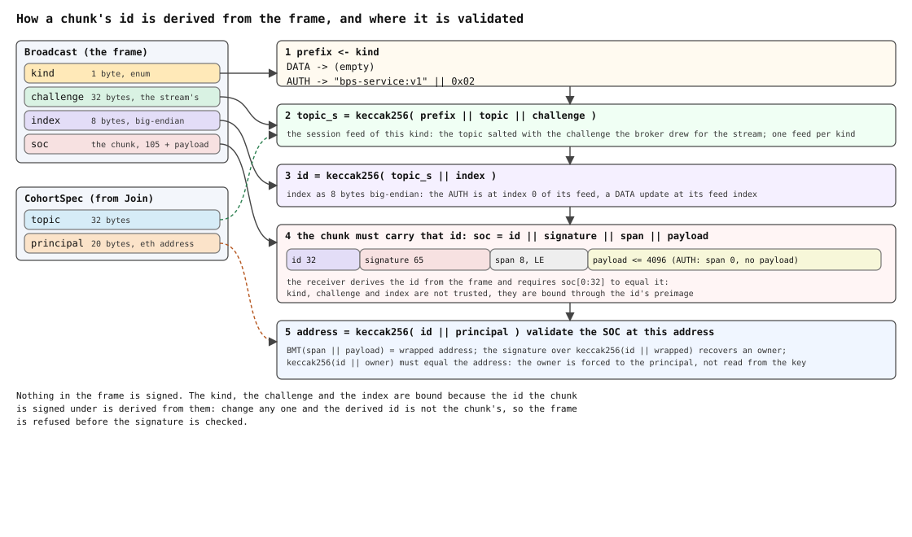

<!-- Base SWIP of the Broadcast Pub/Sub (BPS) family. Rewritten from the first draft in
PR #111 after review: no history, no bandwidth incentive, no service messages, singlehop
only, one mode only — an explicit single publisher (live video streaming). Rev 3: the
publisher role is claimed by signing a broker-issued challenge (the first draft had a
challenge; rev 2 wrongly replaced it with a static signature). Rev 4: the claim is carried
as a single-owner chunk (`Auth`) and verified by the ordinary SOC code; the data frame is
`Broadcast`. Rev 5: `Broadcast` carries the chunk data alone — the receiver forms the
address it validates against from the owner it already knows — and `wrong_owner` folds
into `invalid_soc`. Rev 6: the `Auth` type goes; the claim is a `Broadcast` whose chunk
payload is a service message of kind `CLAIM`, and nothing on the wire is told apart by
shape. Rev 7: the challenge is drawn at random per stream, not derived — a derived one
let whoever had captured the admin's claim replay it once the admin dropped — and it
salts the feed topic for the session, so every chunk of the session is signed under it:
the first publication is the claim, there is no claim chunk, no service message, no
credential in `Join`, and `Join` carries the spec and the peer's identity only; a
stream that says it is the admin's is admitted outside the fan-out bound, silent, until
it claims. Rev 8: the chunk is an ordinary single-owner chunk with its full id, and the
frame carries what the id was derived from — the kind, the challenge and the index —
next to it; the challenge is 32 bytes; an empty chunk of kind `AUTH` claims a stream
that has nothing to publish yet; a chunk that does not validate disconnects. Rev 9,
after the implementation (bee #5626) caught up: the fields are `principal` and
`identity`, the protocol is `bps/1.0.0`, the deadline and its counter say `auth`; an
index of 2⁶⁴−1 is invalid; the frame that upgrades a pending stream counts as activity;
a subscriber resets on a delivery that does not validate; a creating principal displaces
a publisher-less cohort at the cohort bound. Rev 10: the `AUTH` — the empty chunk at
index 0 of the session's `AUTH` feed — is the only way a stream authenticates, and a
pending stream sends nothing else; an update is accepted on a publisher stream only, so
nothing upgrades a stream from the data path; an `AUTH` on a publisher stream is a
heartbeat; what earlier revisions called the claim is the auth; a glossary, an outcomes
table and a figure of the id derivation are added.
SWIP-60 (PR #104) is the
full singlehop protocol and extends this wire without changing it; see "Relation to
SWIP-60". Open points are marked (?). -->

- **Business line**: a live stream on Swarm — one author, an audience, real time, no
  storage round trip and no polling: video/audio streaming, a price ticker, a game's
  server-authoritative state, a log tail. The stream is a feed, so the author can
  persist the same updates for anyone who missed the live run.
- **Dev line**: implement one libp2p protocol, `bps/1.0.0`, with the three frames
  below — one broker, direct streams, one publisher whose every message is signed under
  a challenge the broker issued for its stream, read-only subscribers — and nothing
  else: **no history, no bandwidth
  incentive, no roster or end-of-stream messages, no Bee API, one hop, one mode.** Done
  when a broker, a
  publisher and subscribers from independent implementations interoperate per the
  conformance section. Everything the family adds — the admin's service messages and the
  Bee API, multiple publishers, self-indexed feeds, multihop — extends this wire without
  changing it.
- **DISC change**: NO. A new p2p protocol surface; no storage, retrieval or incentive
  change.

## Simple Summary

BPS-lite is a real-time broadcast protocol: a kind of push notification on a *channel*
that anyone can subscribe to and one participant can publish on. Each channel defines
its own cohort — a set of nodes connected through a unique central broadcaster node, the
**broker**; every node in the cohort is directly connected to the broker, hence
*singlehop*. A channel is identified by its spec — a feed topic and the address of its
**admin**. Anyone joins by sending that spec and its own address; the broker answers
with a **challenge** drawn at random for that stream, and for the life of the stream the
channel's feed topic is salted with it: a publisher's messages are ordinary single-owner
chunks that are the higher-index updates of that session feed, each sent in a frame that
names its kind, the challenge and its index, so that any receiver derives the id the
chunk must have. The stream is authenticated by an **`AUTH`**: the empty chunk at index 0
of the session's `AUTH` feed, signed under the same challenge; until it arrives the
stream receives nothing and may send nothing else. The broker accepts an update iff the
frame carries the stream's challenge, its index is at least the channel's cursor, and
the chunk validates as the admin's single-owner chunk at the derived id, and delivers
the frame unchanged to every subscriber stream — never to a publisher's. All other
joiners are subscribers and verify the same way, end to end: the broker can withhold,
never forge. A channel ends when it goes idle.

## Motivation

SWIP-60 spans several cohort configurations, five topic bindings, a roster control plane
on a service feed, a history flag and the Bee API. That is the right target for the
reference implementation and too much for a second, independent one whose application
is one author broadcasting to an audience. BPS-lite names that one configuration and
specifies only what it needs, so that a second team can implement and conformance-test
it from three frames — and so that it stays the **base** of the family: nothing here is
a divergence to reconcile later, because the fuller protocol extends these frames.

One publisher over a feed also removes what the fuller protocol has to carry: a dedup
window (the feed cursor replaces it), a roster and the service feed that carries it (there
is nothing to announce), a publisher regime (there is one publisher), and any question of
who may write (the admin, proved by its signature on every message).

## Specification

The key words MUST, MUST NOT, REQUIRED, SHOULD, RECOMMENDED and MAY are to be interpreted
as described in RFC 2119. Terms — cohort (a channel's set of nodes), broker, admin,
subscriber — are SWIP-60's.

### Terms

| term | meaning |
|---|---|
| **channel** | what an application streams on: a feed topic and its author's address, `(topic, principal)`, independent of any broker |
| **cohort** | the live state of one channel at one broker: the streams attached under one spec, created by the first `Join` that names the spec, reclaimed by inactivity |
| **cohort spec**, `CohortSpec` | `{topic, binding = FEED_TOPIC, principal}`: the cohort's identity, carried in full in every `Join` |
| **topic** | 32 bytes: the channel's feed topic |
| **principal** | the 20-byte address whose single-owner chunks the cohort carries — the publisher; where the family's control plane is meant, the **admin** |
| **broker** | the full node every stream of the cohort is attached to: it validates, keeps the cursor and fans out; it can withhold, never forge |
| **peer** | a node connected to the broker; one peer connection may hold several streams |
| **stream** | one libp2p stream `/swarm/bps/1.0.0/bps` from a peer to the broker, for one cohort and one identity: the unit of role, flow control and teardown |
| **identity** | the address a stream declares in `Join`: the one it publishes as, if it may |
| **role** | what a stream may send and receive, settled by its identity and its auth: **subscriber stream** — any identity but the principal's; receives every delivery, sends nothing. **Pending stream** — declared the principal, not yet authenticated; receives nothing, sends nothing but its `AUTH`, admitted outside the fan-out bound, disconnected at the auth deadline. **Publisher stream** — a pending stream after its `AUTH`; sends publications and heartbeats, receives nothing |
| **frame** | one protobuf message on a stream: `Join`, `Ack` or `Broadcast`; what a frame is follows from the stream's direction and role, never from an envelope |
| **handshake** | the first frame each way: `Join{cohort, identity}` from the peer, `Ack{status, challenge}` from the broker |
| **challenge** | 32 bytes the broker draws at random for each stream and sends in the `Ack`: it salts the session feed and is never persisted or reused |
| **single-owner chunk**, SOC | `id (32) ‖ signature (65) ‖ span (8) ‖ payload (≤ 4096)`, stored and validated at `keccak256(id ‖ owner)`; every chunk on this wire is one |
| **kind** | what a chunk is: `DATA` or `AUTH` (SWIP-60 adds `EOS`, `ROSTER`); carried in the frame, it selects the feed's prefix |
| **session feed** | the channel's feed salted for one stream: topic `keccak256(prefix ‖ topic ‖ challenge)`, one feed per kind, each with its own index sequence; the chunk id is `keccak256(topic_s ‖ index)` |
| **index** | the chunk's position on its feed: 8 bytes big-endian in the frame and in the id's preimage |
| **update**, publication | a `DATA` frame from a publisher stream: one chunk of the session's `DATA` feed |
| **auth** | the act and the frame that authenticate a stream: the **`AUTH`**, an empty SOC at index 0 of the session's `AUTH` feed, which upgrades a pending stream and is never delivered |
| **heartbeat** | an `AUTH` on a publisher stream: counts as activity, does nothing else |
| **delivery** | an accepted update forwarded unchanged — chunk, kind, challenge, index — to every subscriber stream |
| **fan-out set** | the subscriber streams of a cohort, bounded per cohort |
| **cursor** | the lowest `DATA` index accepted next: the broker keeps one per cohort, a subscriber one per channel |
| **retransmit** | a `DATA` frame below the cursor: dropped and counted, not a violation |
| **violation** | a frame a stream may not send, or a chunk that does not validate: dropped, counted, the stream reset, the peer blocklisted |
| **inactivity deadline** | how long a cohort survives without an accepted frame; the **auth deadline** is how long a pending stream has to send its `AUTH` |

### The contract

Per cohort: messages come from **the admin, and the admin only**; they arrive at **all
subscribers**; they are **feed updates, in increasing index order**.

### Topology and roles

- **Broker**: one full node per cohort. Every peer holds one direct libp2p stream per
  (peer, cohort, identity) to it — libp2p protocol `/swarm/bps/1.0.0/bps`: name `bps`,
  version `1.0.0`, stream `bps`. Depth is 1 by construction:
  no relaying, no referral. Broker discovery is out of scope; deployments configure the
  broker.
- **Principal = the admin = the publisher**: the address the cohort spec names as
  `principal`. It is the only
  identity whose messages are accepted. It need not be first to join; the cohort does
  not end when its stream goes away; and it may publish from any node, or from two.
- **Subscriber**: joins by naming the cohort and its own address, receives, never
  publishes. A publication from a subscriber stream is a protocol violation.
- **Publisher and broker are distinct nodes**; brokering for oneself is out of scope.

### The cohort spec

Three fields, no others:

| field | value |
|---|---|
| `topic` | 32 bytes: the feed topic |
| `binding` | `FEED_TOPIC`: the stream is a feed on the topic — on the wire, the session feed on `topic_s = keccak256(topic ‖ challenge)`, whose signed id is `keccak256(topic_s ‖ index)` |
| `principal` | 20-byte address: the admin, who publishes |

**The spec is the cohort's identity.** It has a **canonical serialisation** —
`Marshal(spec)`: fields in number order, unset fields not emitted — and cohorts are keyed
by it: two peers naming byte-identical specs at a broker are in the same cohort; a spec
that differs in any field names a different one. The invite for a stream is therefore the
spec plus the broker: `topic`, `principal`, broker address. No publisher regime, no roster, no
audience flag, no history flag, no proximity constant: a BPS-lite broker answers any
value outside this table with `REJECTED`, and ignores fields it does not define, as
proto3 does. Capacity is not in the spec: a cohort cannot dictate a remote node's
connection count.

### Wire format

Normative and complete. Field and enum numbers are shared with SWIP-60, which extends
these messages by adding fields, values and nothing else. An unset enum
(`*_UNSPECIFIED`, the proto3 zero) is not a legitimate wire value: receivers MUST reject
a message carrying one.

```proto
syntax = "proto3";
package bps;

// What the topic binds to. One binding.
enum TopicBinding {
  TOPIC_BINDING_UNSPECIFIED = 0; // invalid on the wire
  FEED_TOPIC                = 4; // the stream is a feed on the topic; on the wire the
                                 // session feed (see Broadcast)
}

// The cohort's identity. Fixed by whoever joins first; immutable; keyed by its
// canonical serialisation.
message CohortSpec {
  bytes        topic   = 1; // 32 bytes
  TopicBinding binding = 2; // FEED_TOPIC
  bytes        principal = 3; // 20 bytes, required: the admin
}

// Peer -> broker: the first frame on a fresh stream. Creates the cohort if no live
// cohort has this spec, attaches to it otherwise. Nothing else is ever in it — no
// cursor, no credential: the declared identity makes the stream pending or a
// subscriber, and a pending stream becomes a publisher stream by its AUTH.
message Join {
  CohortSpec cohort   = 1;
  bytes      identity = 2; // 20 bytes, required: the address the stream publishes as
                           // if it publishes, which only the principal may; a stream
                           // declaring the principal is admitted outside the fan-out
                           // bound and receives nothing until it authenticates
}

enum Status {
  STATUS_UNSPECIFIED = 0; // invalid on the wire
  OK                 = 1;
  FULL               = 2; // a capacity bound (see Resource bounds)
  REJECTED           = 3; // a spec value outside this SWIP, or a malformed Join
}

// Broker -> peer, answering Join. A non-OK Ack ends the stream.
message Ack {
  Status status    = 1;
  bytes  challenge = 2; // iff OK: 32 bytes drawn at random for this stream — the salt of
                        // its session feeds; held for the stream's life, never
                        // persisted, never reused
}

// What a chunk on this wire is. BPS-lite has two kinds; SWIP-60 adds the admin's.
enum Kind {
  KIND_UNSPECIFIED = 0; // invalid on the wire
  DATA             = 1; // an update of the stream's feed
  AUTH             = 2; // the empty chunk at index 0 of the session's AUTH feed:
                        // authenticates a pending stream, is a heartbeat on a
                        // publisher stream, is never delivered
}

// Every frame after the handshake: publisher -> broker a publication or an auth,
// broker -> subscriber a delivery of the same frame. The chunk is an ordinary
// single-owner chunk, travelling as its chunk data with its full id:
//   soc = id (32) || signature (65) || span (8, LE) || payload (<= 4096)
// and the frame carries what that id was derived from:
//   prefix  = (empty)                      kind == DATA
//           = "bps-service:v1" || kind     any other kind, kind as one byte
//   topic_s = keccak256(prefix || topic || challenge)
//   id      = keccak256(topic_s || index)  index as a uint64 big-endian
// The receiver derives the id, requires the chunk's to equal it, forms the address the
// chunk must have — keccak256(id || principal) — and validates the chunk against it with
// the ordinary SOC code.
message Broadcast {
  bytes  soc       = 1;
  Kind   kind      = 2;
  bytes  challenge = 3; // 32 bytes: the challenge of the stream the chunk was signed for
  uint64 index     = 4; // the chunk's index on its feed
}
```

Three frames — `Join`, `Ack`, `Broadcast` — the one message they carry, `CohortSpec`,
and three enums: `TopicBinding`, `Status`, `Kind`. There is no envelope: **what a frame is follows from the stream's direction
and role, and what a chunk is from the frame's `kind`** — which, like the challenge and
the index beside it, is not taken on trust: all three are in the preimage of the id the
chunk is signed under. The first peer-to-broker frame is a `Join` and the first
broker-to-peer frame an `Ack`; after that every frame is a `Broadcast`: a publisher
stream sends publications and heartbeats, the broker sends deliveries, and a pending
stream sends its `AUTH` and is a publisher stream or is reset. A frame that is not what
its stream may send is invalid.

### Handshake: `Join`, the challenge, the session feed, the auth

Every peer sends `Join` as the first frame on a fresh stream, carrying the full
`CohortSpec` and its `identity`: the address the stream publishes as, if it
publishes — an assertion, proved only by the signatures that follow. Nothing else is in
it: no cursor, and no credential, because a credential that could be presented in a
`Join` could be presented by whoever captured it.

The broker compares the spec against its live cohorts: **no match → the cohort is
created** with the joiner attached; **match → the joiner is attached** to it. Anyone may
create, including a subscriber arriving before the admin: a publisher-less cohort costs
the broker one map entry until the inactivity deadline reclaims it, and can accept no
message. There is nothing to pre-register and no "unknown topic".

**The challenge.** With `Ack{OK}` the broker sends a **challenge**: 32 bytes it draws at
random for this stream, holds for the stream's life, and never persists or reuses — on
every stream, whatever its `identity`. It is not a secret: it travels in the clear in every
frame of the session. It is a **freshness mark**: it exists on this stream only, and
nothing signed for another stream, another cohort, another broker or an earlier session
of the same peer carries it. Anyone may obtain one by joining, and gains nothing by it.
A peer treats a challenge of any other length as a protocol error. A subscriber's
challenge is unused in BPS-lite — it is issued so that the family can upgrade the same
stream later — and is never compared with anything.

**The session feed.** For the life of the stream the publisher does not write the
channel's feed but the **session's**: the feed on the channel's topic salted with the
challenge,

```
prefix  = (empty)                           for DATA
        = "bps-service:v1" ‖ kind           for every other kind, kind as one byte (?)
topic_s = keccak256(prefix ‖ topic ‖ challenge)
id      = keccak256(topic_s ‖ index)        topic 32, challenge 32, index 8 bytes big-endian
```



— an ordinary feed, addressable as `(admin, topic_s)` by ordinary feed tooling, and one
of its own per kind, each with its own index sequence. The chunk is an ordinary
single-owner chunk with that id in its `id` slot, and the frame carries beside it the
three things the id was derived from — `kind`, `challenge`, `index` — because a
subscriber does not know which stream a delivery came from and has no other way to learn
a publisher's challenge. None of the three is taken on trust: change any of them and the
derived id is no longer the one in the chunk the publisher signed. The salt is what makes
a session chunk worthless anywhere but on the stream it was signed for; the index is
what the cursor and SWIP-65's gap detection read. The publisher signs each update once
per stream it holds, and MUST NOT reuse a `DATA` index across sessions: a subscriber
cannot tell sessions apart, and its cursor per `(topic, admin)` is what keeps an earlier
session's update from standing in for a later one (see Security considerations). The
same wrapped payload signed again under the channel's own id, `keccak256(topic ‖ index)`,
is the update for storage (see Rationale).

**The pending stream.** A `Join` that declares the principal as its `identity` is
admitted outside the fan-out bound, as a **pending stream**: attached, in no fan-out
set, receiving nothing and sending nothing but its `AUTH`, until that **authenticates**
it or the **auth deadline** disconnects it (*Resource bounds*).
That is what keeps a full audience, or an old stream of the admin's that the transport
has not yet reaped, from locking the admin out, and it is worth nothing to anyone but
the admin: a pending stream costs the broker a map entry and a challenge for one
deadline and delivers nothing. Every other `Join` is a **subscriber stream**, within the
bound.

**The auth.** A pending stream authenticates as the publisher with its **`AUTH`**: the
empty chunk — span 0, no payload — at **index 0** of the session's `AUTH` feed,
`keccak256("bps-service:v1" ‖ 0x02 ‖ topic ‖ challenge)`. A session has exactly one such
chunk, and it is the only frame a pending stream may send: an update from a pending
stream is a violation, like a frame from a subscriber. The broker checks the `AUTH` as
it checks every frame (*Validation* below): that its `challenge` is the stream's, that
the chunk has the id derived from the frame and validates as the admin's single-owner
chunk at `keccak256(id ‖ principal)` — signature, digest and signer in one existing call,
the owner forced rather than recovered, since recovering a signer always yields *some*
address — and that it is empty. If it does, the stream **upgrades** to a **publisher
stream**; the `AUTH` is never delivered, moves no cursor, and counts as activity for the
cohort's lifetime. A signature under this challenge is possible only for the key of
`identity` and only after the `Ack`, so the `AUTH` proves the key and the session at
once, and nothing else has to. There is **no reply**: the publisher sends its `AUTH` and
its first update back to back, and learns the outcome from whether the stream survives.
On a publisher stream the same `AUTH`, sent again, is a **heartbeat**: it counts as
activity and does nothing else, so a publisher that pauses holds its cohort past the
inactivity deadline without inventing an update.

A frame whose `challenge` is not the stream's is not of this session: it is dropped and
counted (`wrong_challenge`), and a broker MAY reset the stream — it is what an update the
admin's node signed for its previous stream and still had queued looks like when it
arrives after the `AUTH` — before it, the same update is a violation (`wrong_stream`) —
so a publisher SHOULD discard or re-sign what it had queued for a stream that was reset,
and sends nothing on the new stream before its `AUTH`. A
chunk that does not validate is a protocol violation on any stream: dropped, counted
(`invalid_soc`), the stream reset, the peer blocklisted per the node's policy — one
failed validation is all a connection can cost the broker. So is any frame at all from a
subscriber stream (`wrong_stream`). Several streams MAY be authenticated for the admin at once
— the admin from two nodes, or reconnecting before its old stream is torn down: each has
its own challenge, and the cursor arbitrates.

**The rest of the handshake.** `FULL` answers a `Join` at a
capacity bound, `REJECTED` one whose spec has a value outside this SWIP or whose `identity`
is not 20 bytes. A non-`OK` `Ack`
ends the stream; on `OK` it is retained. A peer whose stream was refused or reset MUST
back off before rejoining (randomised exponential, 1 s to 30 s, full jitter); a broker
MAY reset a stream that retries faster. Without this every reclaim or reset of a cohort
brings its whole audience back at once.

### Frames

After the handshake every frame is a `Broadcast`: a broker sends deliveries, to
subscriber streams; a publisher stream sends publications and heartbeats; a pending
stream sends its `AUTH`. A delivery is the accepted frame, unchanged: the chunk, its kind, the challenge
it was signed for and its index.

**The chunk is an ordinary single-owner chunk.** Its `id` slot holds its full id, as in
any SOC, and nothing in it is rewritten on receipt. What the receiver needs in order to
know which id the chunk must have — the kind, which selects the feed; the challenge,
which salts its topic; the index — travels in the frame, outside the chunk, and the
receiver derives the id from them and the cohort's topic and requires the chunk's to
equal it. A frame whose three fields do not give the chunk's id is invalid, whoever
altered them.

**The frame carries no address.** Recovering a signer always yields *an* address, so the
ordinary SOC validation needs an address to hold the chunk against — and every receiver
has one: in BPS-lite the publisher is the admin, so the expected address of a chunk is
`keccak256(id ‖ principal)`, and validating the chunk against it checks signature, digest
and owner in one call, with the owner forced rather than compared afterwards. Carrying
the address would say nothing the receiver does not already know.

**Kinds.** `DATA` is an update of the session feed; `AUTH` is the empty auth, and the
heartbeat. A frame of
a kind this SWIP does not define is dropped and counted (`unknown_kind`), by a broker on a
publisher stream and by a subscriber alike, and is not a violation — it is what a
full-protocol admin's roster or end of stream looks like here; on a pending stream, which
may send nothing but its `AUTH`, it is one (`wrong_stream`).

**The challenge in the frame** is, at the broker, required to be the stream's own. A
subscriber compares it with nothing — not with its own, and not with the one in earlier
deliveries: a publisher that reconnects publishes under a new one.

### Validation: the feed cursor

The broker keeps one **cursor** per cohort: **the lowest `DATA` index it will accept
next**, initially 0 — index 0 is the first update of every feed. A `Broadcast` arriving
at the broker is accepted iff, in order:

1. it arrived on a **publisher stream**, or it is an `AUTH` on a **pending stream** — any
   other frame is not what its stream may send, a protocol violation: dropped, counted
   (`wrong_stream`), the stream reset, the peer blocklisted per the node's policy;
2. its `kind` is `DATA` or `AUTH` — another kind is dropped and counted (`unknown_kind`);
3. its `challenge` is **the stream's** — otherwise it is dropped and counted
   (`wrong_challenge`), and the broker MAY reset the stream;
4. for `DATA`, its `index` is **`n ≥ cursor`** — otherwise it is a retransmit, dropped
   and counted — and `n < 2⁶⁴−1`: the last index is one no feed has, so that
   `cursor := n + 1` never wraps, and an update at it is a protocol violation as under
   step 5 (`invalid_soc`); for `AUTH`, its `index` is 0 — any other is likewise a
   violation under step 5;
5. the chunk's id is the one **derived from the frame** — `keccak256(topic_s ‖ index)`
   with `topic_s = keccak256(prefix ‖ topic ‖ challenge)` — and the chunk **validates as
   the admin's single-owner chunk**: the receiver forms the expected address
   `keccak256(id ‖ principal)` and runs the ordinary SOC validation against it — the wrapped
   chunk's BMT address matches `span ‖ payload`, and the signature over
   `id ‖ wrappedAddress` recovers an owner that hashes with the id to that address,
   which only the admin's does. An `AUTH` chunk moreover has span 0 and no payload. A
   failure is a protocol violation: dropped, counted (`invalid_soc`), the stream reset,
   the peer blocklisted per the node's policy.

An accepted `AUTH` upgrades a pending stream to a publisher stream, counts as activity
for the cohort's lifetime, and does nothing more — on a publisher stream it is a
heartbeat. An accepted `DATA` frame sets `cursor := n + 1` and is enqueued, unchanged, on
**every subscriber stream** in the cohort. Publisher streams receive nothing: a publisher
never gets its own messages back, on whichever of its streams they were sent.

The four cheap checks precede the signature check on every stream, and the signature
check is paid at most once in vain per connection. A retransmit is the one failure a conforming admin
produces in the ordinary course — reconnecting after a reset, it does not know what the
broker last accepted — and a broker MAY reset a publisher stream whose retransmit rate
exceeds its policy.

**There is no dedup window.** The cursor is total: a message is either at or beyond the
next expected index or it is not, and there is no eviction and no edge. **Gaps are
allowed** (`n > cursor`): they are the publisher's business, and SWIP-65 makes them
detectable and recoverable at the subscriber. A returning admin that continues where it
left off sets the cursor with its first accepted update, never back. A broker enforcing
monotonicity is sound here because one publisher on one hop admits no legitimate
reordering.

Subscribers re-verify every `DATA` delivery as the broker does — steps 4 and 5, against
the spec they joined with and their own cursor, with the kind, the challenge and the
index read from the frame — end to end, whatever the broker did; they never apply step
3, and drop any frame that is not `DATA` — a kind they do not know, or an `AUTH`, which
is never a delivery. A delivery that fails step 5 is a broker forwarding
what it should have refused: the subscriber MUST reset the stream, and SHOULD NOT
rejoin that broker for the cohort (?).

### Outcomes

Every frame the broker receives ends in exactly one of the outcomes below. The wire
carries no error frame: what a peer learns, it learns from the `Ack` status, from its
stream being reset, or from nothing happening. A reset tells the peer nothing about its
cause — a violation, the auth deadline, the inactivity reclaim and a broker restart look
the same from the peer, which backs off before rejoining (*Resource bounds*); the broker
tells them apart in its counters.

| what arrived | from | outcome | counter | the sender sees |
|---|---|---|---|---|
| a `Join` with a binding other than `FEED_TOPIC`, an absent `principal`, or an `identity` that is not 20 bytes | anyone | `Ack{REJECTED}`, stream closed | — | `REJECTED` |
| a `Join` at a capacity bound — fan-out set full, cohorts per broker, cohorts or streams per connection | anyone, except as below | `Ack{FULL}`, stream closed | — | `FULL` |
| a `Join` declaring the principal when the fan-out set is full | the principal's node | admitted as a pending stream outside the bound; at the cohort bound the broker SHOULD reclaim the oldest publisher-less cohort for it (?) | — | `OK` and a challenge |
| any `Broadcast` | a subscriber stream | violation: dropped, stream reset, peer blocklisted | `wrong_stream` | the stream is reset |
| anything but an `AUTH` | a pending stream | violation: dropped, stream reset, peer blocklisted | `wrong_stream` | the stream is reset |
| a kind this SWIP does not define | a publisher stream | dropped | `unknown_kind` | nothing |
| a frame whose challenge is not the stream's | a publisher stream, or an `AUTH` on a pending one | dropped; the broker MAY reset the stream | `wrong_challenge` | nothing, or a reset |
| a `DATA` below the cursor | a publisher stream | dropped | `retransmit` | nothing |
| a chunk whose id is not the one derived from the frame, or that does not validate at `keccak256(id ‖ principal)`; an `AUTH` with a payload or not at index 0; a `DATA` at index 2⁶⁴−1 | a publisher or pending stream | violation: dropped, stream reset, peer blocklisted | `invalid_soc` | the stream is reset |
| no `AUTH` within the auth deadline | a pending stream | stream reset, peer blocklisted for a short time | `auth_timeout` | the stream is reset |
| a valid `AUTH` | a pending stream | the stream upgrades to a publisher stream; activity | — | nothing |
| a valid `AUTH` | a publisher stream | activity, nothing else | — | nothing |
| a valid `DATA` at or above the cursor | a publisher stream | cursor set past it; delivered to every subscriber stream | — | nothing |
| a delivery a subscriber stream cannot take — its outbound queue is full | the broker, towards a subscriber | that stream is reset | `queue_reset` | the stream is reset |
| no accepted frame for the inactivity deadline | — | the cohort is reclaimed, every stream in it reset | — | the stream is reset |
| a delivery of a kind other than `DATA`, or below the subscriber's cursor | the broker, at a subscriber | dropped by the subscriber | — | — |
| a delivery that does not validate | the broker, at a subscriber | the subscriber resets the stream | — | — |

### Lifetime: inactivity

**A cohort ends by inactivity — or, once no stream is attached, at the broker's
discretion — and by nothing the admin or its stream does.** A cohort on which no publisher
stream has had activity — an accepted update or `AUTH` — for the **inactivity
deadline** is reclaimed: the
broker resets every stream in it and forgets it. There is no end-of-stream signal in
BPS-lite — that is one of the admin's service messages, which this SWIP does not have; an
application that needs
"over" to be distinguishable from "paused" sends it in its last update, or waits for the
service feed the family adds.

A publisher stream going away — closed or reset — is therefore not an end: the cohort
and its cursor persist, subscribers stay attached, and the admin rejoins — admitted as a
pending stream whether or not its old one is still held — receives a fresh challenge,
authenticates with an `AUTH` under it, and continues at whatever index it is at. Likewise a subscriber-only cohort waits for its admin until the deadline
reclaims it. A cohort with **no attached streams** MAY be reclaimed at once — nothing
observes the difference beyond a fresh cursor on the next `Join`.

After a cohort is forgotten a later `Join` creates a fresh one with the cursor at 0, and
every stream on it a fresh challenge: nothing the admin signed for the old session is
accepted on the new, so a stale republication is caught at the broker as well as at the
edge, where subscribers keep their own cursor per `(topic, admin)`.

### Resource bounds

All broker policy, none on the wire. The first six bounds are REQUIRED, with the values
given RECOMMENDED where a value is given; the last two are MAY:

| bound | answer | recommended |
|---|---|---|
| subscriber streams per cohort — the fan-out set | `FULL` to the next `Join` — except a `Join` declaring the principal as its `identity`, admitted **outside the bound as a pending stream**: attached, in no fan-out set, receiving nothing, until its `AUTH` upgrades it, or the **auth deadline** disconnects it, with a short blocklist, counted (`auth_timeout`) | implementation-defined; auth deadline 30 s, long enough for a wallet prompt (?) |
| live cohorts per broker | `FULL` to a cohort-creating `Join` — except one declaring the principal as its `identity`, for which the broker SHOULD reclaim the oldest cohort that has never had a publisher stream instead, and answers `FULL` when there is none (?) | implementation-defined |
| **cohorts per peer connection** — a peer cannot flood the broker with bogus cohorts while keeping one legitimate stream open | `FULL` | 16 |
| **streams per peer connection per cohort** — one connection cannot fill a cohort's fan-out set with declared identities | `FULL` | 2 (?) |
| **inactivity deadline** — reclaims a cohort, see *Lifetime* | reset | 10 min |
| outbound queue per subscriber stream, one writer; a full queue resets that stream | reset | 64 frames |
| a peer connection with no live stream | MAY be disconnected at the transport | — |
| a cohort with no attached streams | MAY be reclaimed at once | — |

Any peer can make a broker allocate a cohort simply by joining, which is why the second,
third and fifth bounds exist together: a cohort costs a map entry, a peer can hold only
a bounded number of them, and none survives idleness. The pending stream is what keeps
an audience that fills the cohort while the admin is away — or an old stream of the
admin's that the transport has not yet reaped — from locking the admin out, and it is
not a slot anyone can squat: it receives nothing, may send nothing but its `AUTH`, costs
a map entry and a challenge for one auth deadline, and one connection holds a bounded
number of streams per cohort.
Declaring the principal's address buys exactly that. A cohort without a publisher is
worth less than one whose principal has arrived, which is why a creating principal
displaces one rather than being turned away: otherwise a handful of throwaway peers
could hold every cohort slot for an inactivity deadline and keep a principal out. The
broker has no
delivery obligation: a reset for a full queue is a recoverable liveness fault, and
blocking fan-out on one slow subscriber would punish the cohort.

### Relation to SWIP-60

BPS-lite is the **base** of the BPS family and SWIP-60 is its full singlehop protocol.
The relation is subset, and it is kept in one direction only — **later revisions extend
this wire, they never change it**:

- a BPS-lite peer sends only frames the full protocol accepts, and a BPS-lite broker
  accepts only what this SWIP defines: a spec value outside this SWIP is `REJECTED`, a
  field this SWIP does not define is ignored, so a fuller spec is served as the lite spec
  its known fields spell — a feed-topic cohort whose admin later publishes a roster is,
  at a BPS-lite broker, a live stream whose roster is dropped (`unknown_kind`) and whose
  grantees, being subscriber streams here, are reset at their `AUTH`; an admin that
  wants a roster needs a full broker;
- a BPS-lite publisher and subscriber at a full broker are conformant peers of a
  single-publisher live-stream cohort; the full broker's additions (the admin's service
  messages) reach them as frames they drop;
- validation here is stricter, never looser: the cursor refuses out-of-order
  retransmits; no frame a BPS-lite broker accepts is one a full broker refuses.

What SWIP-60 adds on this wire: cohort parameters (`publishers`, `history`, `closed`),
the admin's service feeds as two more kinds (`EOS`, `ROSTER`), the auth of any rostered
address and none at all under `ALL`, pending streams for rostered addresses, and the Bee
API.

## Rationale

**Why a feed, not an anchor.** The first draft bound the topic to a single SOC address
(`ANCHOR`), so that authorship followed from the topic and no publisher field was
needed. That collapses the wrong thing: one address for every message means messages
are told apart only by their wrapped payload, dedup needs a window, order is invisible,
and nothing connects the live stream to storage. Binding to a feed keeps the publisher
explicit — one address in the spec, one owner check per message — and buys order, gap
detection, replay-freedom and persistence for the same money: the stream *is* a feed,
live.

**Why `Join` carries the spec, and there is only `Join`.** A joiner that arrives with a
topic and learns the spec from the broker has to be told the spec by someone it then
has to verify. For a live stream the spec is a topic and an address; the invite that
names the broker names them too. Once every joiner carries the spec, the spec is the
cohort's identity, the broker is never trusted about it, `Ack` is a status and a
challenge, and the first-joiner-creates rule is the natural one.

**Why a challenge, and what it protects.** A static signature — over the topic and the
admin, say — would be replayable by design, and the argument that a replayed role can
publish only what its owner already signed is true and beside the point: replaying the
admin's signed updates is *history*, and a first-time viewer receiving them from the
beginning is caught up, not deceived. What a replayed signature buys is an **identity**:
a stream the broker treats as the admin's — exempt from the fan-out bound and its queue
policy, and in SWIP-60 admitted to a `closed` cohort and promoted by a roster. A challenge issued for this stream and answered by a signature
under it is what makes the identity worth exactly the key.

**Why the challenge is random, per stream.** A challenge derived from a broker secret
and the address is issued without being stored, and it is the same on every stream the
address opens while the broker runs — which is the flaw: whoever once captured the
admin's answer to it (the node that bridged the admin, say) can present it again after
the admin drops, and holds the admin's identity at this broker until it restarts. A
challenge drawn at random for the stream is answered on that stream or nowhere; the
broker keeps it as long as the stream, which it keeps anyway, and nothing survives the
stream to be replayed.

**Why the challenge salts the feed.** A challenge
answered once, by the auth, protects the auth; the updates that follow are signed for
the channel, and whoever captured them from one session can present them in another — to
a broker whose cursor has restarted after a reclaim, they are fresh. Salting the topic
with the challenge signs every chunk for the session it was published in, so there is
nothing to replay: a chunk of another session, another broker or the channel's own feed
does not have the id this stream's challenge gives. Because the challenge is specific
to the stream — one peer, one cohort, one session — being under it is all a chunk has to
prove, and nothing else needs signing: no credential in `Join`, no field in the payload;
the `AUTH` is a chunk under it like every other.
Salting the *topic* — `keccak256(topic ‖ challenge)` is a topic like any other — keeps
the session feed an ordinary feed, so that a subscriber that saves the run has a feed it
can replay with ordinary tooling. What it costs: the publisher signs once per stream it
holds, and the live chunks are the session feed's, not the channel's — a publisher that
wants the run persisted under the channel's own topic signs the same wrapped payloads
again under `keccak256(topic ‖ index)`, which is one signature each over a chunk it
already has (?).

**Why the frame carries the kind, the challenge and the index.** A chunk signed under a
salted id can be checked only by someone who can derive that id, and a subscriber knows
neither the publisher's challenge nor, from a hash, the index. They could be packed into
the chunk — the challenge and the index squeezed into the 32 bytes of the `id` slot, the
kind inferred from the shape of what is left — and that is a format of its own to
specify, with a truncated challenge and a slot that is no longer a SOC's. Carried in the
frame they are three plain fields, the chunk stays an ordinary single-owner chunk with
an ordinary id, and nothing is lost: the fields are not signed, and do not need to be,
because the id they must reproduce is.

**Why the `AUTH` is the only auth, and why an empty chunk at index 0.** Any chunk under
the stream's challenge proves what an auth has to prove, and revisions 7–9 let the first
update be it. That saved one frame and cost two wrinkles: a pending stream's update had
to be validated before the cursor was consulted, so that an admin reconnecting below the
cursor still authenticated, and the role transition sat inside the data path, where
whether an upgrade-by-retransmit counts as activity had to be decided. With one auth
frame the pending stream is a one-frame state machine — it accepts its `AUTH` and
nothing else — the checks run in one order on every stream, and the dApp signs one
well-defined chunk per session before its first update, for which it had to wait for the
challenge anyway. The chunk is empty because the auth has nothing to say, and at index 0
because a session has one: the `AUTH` feed is the salted topic's, so index 0 is fresh on
every stream, and a heartbeat is the same chunk sent again. It lives on a feed of its own
so that it takes no index from the stream's, and it is a kind, not a frame, because
every kind begins the same way: with the validation of a single-owner chunk.

**Why the identity is on the stream, and the address is declared.** A peer connection is
a node; a stream is a (node, cohort, identity) triple; the identity that matters is the key that
signs the messages on that stream. Declaring the address in `Join` admits as pending
only a stream that says it is the admin's, and tells the broker which address to hold
the stream's chunks to. Binding the identity to the stream is what lets one
node carry different identities on different streams — and, in SWIP-60, what lets a
subscriber stream be upgraded by its `AUTH` when the admin grants it.

**Why the frame carries no address.** The ordinary SOC validation checks that the signer
hashes, with the id, to the chunk's address; a receiver that only recovered a signer
would accept any signature at all. But the address is not information the sender has and
the receiver lacks: publishing is restricted to known owners — the admin here, an
authenticated or declared address in SWIP-60 — so every receiver forms the expected address itself and
holds the chunk to it. That is the same check with the owner forced, and 32 bytes fewer
on every frame.

**Why no reply to an auth.** After the handshake each direction carries one frame type,
and the wire has no envelope. A reply would be a second broker-to-peer type on a stream
that carries deliveries, with nothing to tell them apart. It is also unnecessary: streams
are ordered, so a publisher sends its `AUTH` and its first update together and
learns the outcome from whether the stream survives.

**Why no loopback.** A publisher knows what it published. Echoing it costs a frame per
message on the stream whose back-pressure matters most, and buys no confirmation: a
rejected frame produces no echo either.

**Why the cursor, not a window.** A bounded seen-set is a memory bound with a replay hole
at its edge, and it exists because the general protocol admits many publishers and
duplicate paths. One publisher on one hop has neither. The feed index is a total order,
and "at least the next" is both the dedup rule and the memory bound.

**Why inactivity, and only inactivity.** An end that is *signed* by the admin is one of the
admin's service messages, which this SWIP does not have; an end that is *inferred* from the
admin's stream
turns every transport hiccup into a stream-ending event for the whole audience. So there
is no end: a cohort is a map entry that lives while it is used and is reclaimed when it is
not. What that gives up — "over" versus "paused" — is the application's to carry until the
service feed arrives.

## Security considerations

Those of SWIP-60, restricted to its live-stream configuration (admin set, the admin
alone publishes, open audience).

**The publisher role takes the key, every time, and the session takes it again.** Every
chunk, the first included, is signed by the publisher's key under an id that only the
challenge of one stream gives. What can be captured and replayed, by whom, and what
stops it:

| replayed | by whom | where | result | stopped by |
|---|---|---|---|---|
| a session's frames, the first included, as they were | anyone who received them — every subscriber, the node that bridged the admin, a relay, the broker itself | any other stream: another node, the same node reconnecting, this broker after a restart or a reclaim, another broker, another cohort | dropped before any signature is checked (`wrong_challenge`) — or, from a subscriber stream, or as anything but an `AUTH` from a pending stream, a violation (`wrong_stream`) | the frame's challenge is not the receiving stream's |
| a session's chunks, with the receiving stream's challenge put in the frame | the same | the same | a violation: the stream reset, the peer blocklisted | the challenge is in the id's preimage: the derived id is not the chunk's |
| a frame with its kind, challenge or index altered | the broker, towards its subscribers | a subscriber | refused | the same: all three are in the id's preimage |
| a session's update, at an index the publisher reused in a later session | a broker that carried the earlier session | a subscriber, in place of the later session's update | delivered: the subscriber cannot tell sessions apart | the publisher never reusing an index; then the earlier update is below every returning subscriber's cursor, and history to a first-time one |
| the challenge | anyone, by joining and declaring the admin's address | this broker | harmless: it proves nothing without the key; the declaration buys a pending stream, which receives nothing, until the auth deadline, then a blocklist | the `AUTH`, not the challenge, is the credential |
| the challenge, forwarded | a relay or impostor broker the publisher was pointed at: it joins the honest broker as the admin, hands the challenge it receives to the publisher as its own, and forwards what the publisher signs under it | the honest broker | the publisher's own updates reach the honest broker, as the publisher's — the relay is a transparent hop that can withhold, not author; the publisher published to the audience it meant to and one more | nothing needed: a relay of a public broadcast is what SWIP-61 makes of every node, and there is no identity to steal, only updates to carry |
| an update of the channel's own feed, `keccak256(topic ‖ index)` | anyone holding it | any stream | a violation | no challenge gives the channel's own topic: the derived id is not the chunk's |
| an `AUTH` as a `DATA`, or the reverse | anyone | any stream | a violation | the kind selects the feed: the derived id is not the chunk's |
| the admin's updates, on the admin's own publisher stream | the admin's node, or the admin | this session | dropped as retransmits, counted | the cursor |
| the admin's updates, on another node's publisher stream | a second node the admin publishes from | this broker | valid on each stream — each has its own challenge, and the admin signed for each — and delivered once: the first to arrive moves the cursor, the other is a retransmit | the cursor |
| the admin's updates, in the channel's own feed | the admin, a broker or a subscriber that saved them | storage, to first-time viewers | delivered — **history**, genuine updates in order, a late viewer caught up | nothing needed; returning viewers keep their cursor per `(topic, admin)`, first-time freshness is the payload's (SWIP-65) |
| a `Join` | anyone | anywhere | attaches or creates, as any join does — no privilege | nothing needed; the bounds and the inactivity deadline |

**No confidentiality**: the broker and every subscriber see plaintext; applications
encrypt payloads. **The broker withholds, never forges**, and a withheld update is
visible as a gap in the index. **No end signal**: a broker can end a cohort for its
audience by resetting their streams, which is withholding, nothing more. **Resource
bounds are policy; the four capacity bounds, the inactivity deadline and the queue bound
are required** (above); the cursor
removes the dedup-window bound and its edge, and the challenge is 32 bytes per stream
the broker holds anyway; a pending stream is a map entry and a challenge for one auth
deadline, and delivers nothing; a chunk that does not validate ends the stream that sent
it, so no connection buys more than one signature check with a forgery. A subscriber
that publishes is a protocol
violation and is blocklisted; a squatted cohort is one map entry for one inactivity
deadline, and a peer can hold only a bounded number of them and of streams per cohort.

## Conformance (definition of done)

An implementation is BPS-lite conformant when:

1. a broker accepts a `Join` whose spec is `{topic, FEED_TOPIC, principal}` and answers any
   other binding, an absent `principal`, or an `identity` that is not 20 bytes with `REJECTED`,
   ignoring fields it does not define;
2. a `Join` for a spec with no live cohort creates it, whoever sends it; a `Join` with a
   byte-identical canonical serialisation attaches to it; no status other than `OK`,
   `FULL` and `REJECTED` is ever sent;
3. every `Ack{OK}` carries a challenge of 32 bytes drawn at random for that stream, held
   for the stream's life and never persisted or reused, and no `Join` carries or is
   answered on any credential;
4. a `Join` declaring the principal as its `identity` is admitted outside the fan-out bound as a
   pending stream that receives nothing and may send nothing but its `AUTH` — the empty
   chunk at index 0 of the session's `AUTH` feed — which authenticates it and upgrades
   it to a publisher stream; no reply is sent;
5. a `Broadcast` is accepted iff it arrives on a publisher stream or is an `AUTH` on a
   pending stream, its kind is `DATA` or `AUTH`, its challenge is the stream's, for
   `DATA` its index is at least the cursor and for `AUTH` it is 0, and its chunk has the
   id derived from the frame —
   `keccak256(keccak256(prefix ‖ topic ‖ challenge) ‖ index)`, the prefix empty for
   `DATA` and `"bps-service:v1" ‖ kind` otherwise — and validates as a single-owner chunk
   at `keccak256(id ‖ principal)`; an accepted `DATA` frame sets the cursor past its index
   and is delivered unchanged to every subscriber stream in the cohort, and to no
   publisher stream; an `AUTH` is never delivered, counts as activity, and with a
   payload or at another index is invalid;
6. a frame from a subscriber stream, a frame other than an `AUTH` from a pending stream,
   and a chunk that does not validate on any stream, is a violation: dropped, counted,
   the stream reset, the peer blocklisted; a frame of
   another kind is dropped and counted; a frame under another challenge is dropped and
   counted, and the stream MAY be reset;
7. `n < cursor` is counted as a retransmit, not a violation; there is no other dedup
   state; gaps are accepted; index 0 is accepted on a fresh cohort and index 2⁶⁴−1 on
   none;
8. a cohort with no accepted frame for the inactivity deadline is reclaimed, every
   stream in it reset; a publisher stream going away does not end the cohort;
9. the capacity bounds are enforced — streams per cohort, cohorts per broker, cohorts
   per peer connection, streams per peer connection per cohort — `FULL` is issued at
   capacity and nothing else is, except that a `Join` declaring the principal as its
   `identity` is admitted as a pending stream outside the fan-out bound and, at the
   cohort bound, SHOULD displace the oldest publisher-less cohort when there is one (?); a pending stream is disconnected if it has not authenticated
   within the auth deadline; a subscriber stream whose outbound queue is full is reset;
10. a subscriber re-verifies every `DATA` delivery against the spec it joined with and
    its own cursor, deriving the id from the frame's kind, challenge and index, compares
    the frame's challenge with nothing, drops any frame that is not `DATA` — a kind it
    does not know, or an `AUTH` — and resets the stream on a delivery that does not
    validate;
11. a publisher authenticates every stream with its `AUTH` before it publishes on it,
    signs every chunk under the challenge of the stream it sends it on, discards or
    re-signs what it had queued for a stream that was reset, and never reuses a `DATA`
    index across sessions;
12. a BPS-lite publisher and subscriber interoperate with a full SWIP-60 broker on a
    single-publisher cohort.

A broker MUST expose per-cohort counters for the silent outcomes — `wrong_stream` (a
frame from a subscriber stream, or anything but an `AUTH` from a pending stream),
`unknown_kind`, `wrong_challenge` (a frame whose
challenge is not its stream's), `invalid_soc` (a chunk that does not have the derived
id, or does not validate at the expected address — bad signature, wrong owner or wrong
digest alike — or a `DATA` at index 2⁶⁴−1, or an `AUTH` with a payload or at an index
other than 0), `auth_timeout` (a pending stream
disconnected at the auth deadline), `retransmit`, `queue_reset` — since items 5–7 and 9
are unobservable from the wire without them.

## Out of scope (deliberately)

The admin's service messages (roster, end of stream) and the Bee API bridge; multiple
publishers and the auth of a rostered address; the self-indexed payload construction,
gap recovery and persistence of [SWIP-65](https://github.com/ethersphere/SWIPs/pull/106);
multihop ([SWIP-61](https://github.com/ethersphere/SWIPs/pull/105)); history; bandwidth
incentives; broker discovery ([SWIP-59](https://github.com/ethersphere/SWIPs/pull/103));
confidentiality of any kind. Each extends this SWIP's wire without changing it.

## Backwards compatibility

New protocol; no existing behaviour changes. Every message and field number here is
kept by the fuller protocol, which extends by adding fields, values and messages and
never by changing these; a BPS-lite peer ignores fields it does not define.

## References

Full singlehop protocol: [SWIP-60, PR #104](https://github.com/ethersphere/SWIPs/pull/104)
· gap detection and persistence: [SWIP-65 self-indexed feeds, PR #106](https://github.com/ethersphere/SWIPs/pull/106)
· first draft of this SWIP: [PR #111](https://github.com/ethersphere/SWIPs/pull/111)
· origin: [PR #93](https://github.com/ethersphere/SWIPs/pull/93) "Add: pubsub"
· implementation: bee [#5626](https://github.com/ethersphere/bee/pull/5626) (groundwork:
bee [#5597](https://github.com/ethersphere/bee/pull/5597), [#5435](https://github.com/ethersphere/bee/pull/5435))

## Copyright

Copyright and related rights waived via [CC0](https://creativecommons.org/publicdomain/zero/1.0/).
